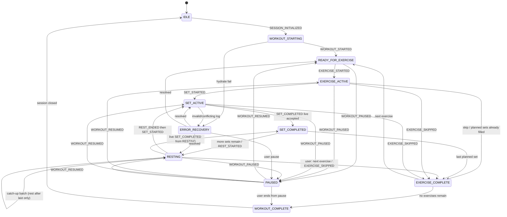
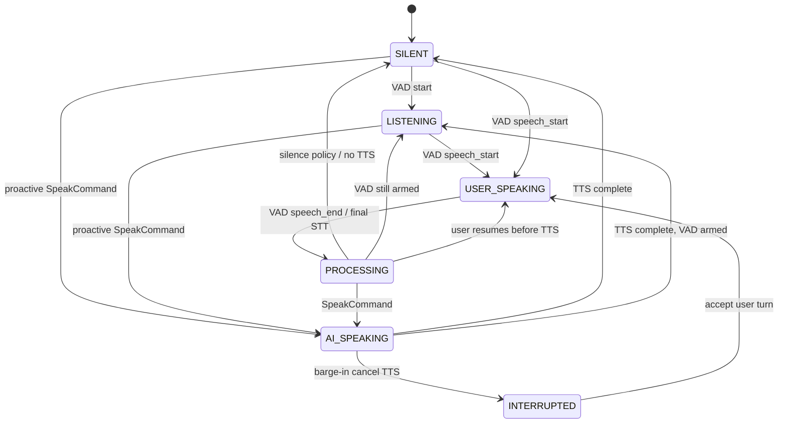
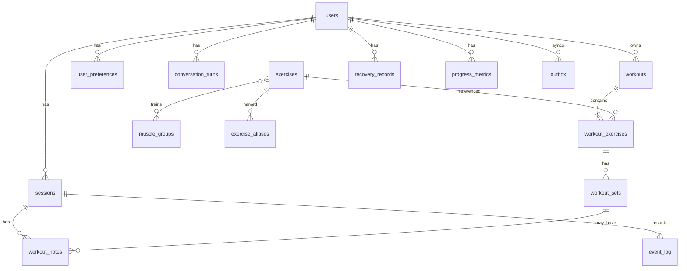
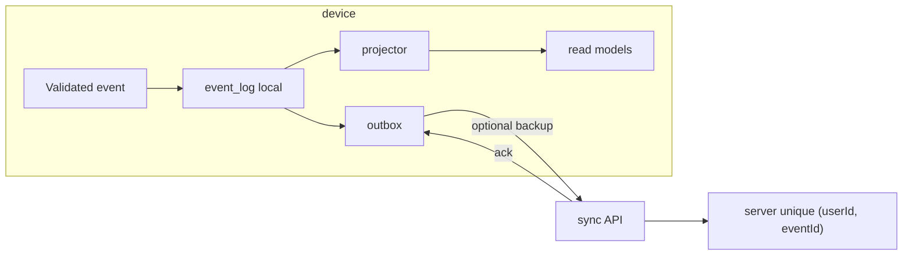

# GymBuddy Living Technical Specification

| Field | Value |
|---|---|
| **Document title** | GymBuddy (AI Gym Companion / AI Personal Trainer) — Living Technical Specification |
| **Author** | GymBuddy engineering |
| **Date** | 2026-08-20 |
| **Status** | Draft (stack locked 2026-08-20: Android/Kotlin/Room; Q3–Q5, Q8–Q10 open) |
| **Product law** | `C:\Users\nande\Downloads\gymbuddy\AI Voice Gym Trainer — Master Product & Build Specification.md` |
| **Project path** | `C:\Users\nande\Downloads\gymbuddy` |
| **Codebase** | Greenfield. No implementation exists. Paths below are *intended* modules that **will** exist. |

This document is the engineering source of truth. It implements the master product specification; it does not reinterpret GymBuddy as a generic fitness tracker with a chatbot.

> Product identity (law): **AI gym companion / AI personal trainer.** Not “workout tracker with AI.”
>
> Final product rule: every design decision answers *“Does this make the user feel like they have a great trainer beside them, without making them operate another app while they are working out?”*
>
> Central MVP hypothesis: *“Does having a natural AI gym companion make people consistently complete and log better workouts?”*

---

## Overview

GymBuddy is a voice-first gym companion. The user starts music, starts this app, puts the phone away, and trains with an AI that already knows today’s plan and last session’s numbers. Natural, unconstrained, multilingual speech becomes structured workout events. A deterministic workout state machine — not the LLM — owns session truth. The LLM interprets language and speaks like a trainer. Persistence is local-first, idempotent, and never invents history.

This specification defines: (1) living-spec discipline that must stay in lockstep with code, (2) the continuous interaction loop as the product kernel, (3) complete feature contracts for every MVP major feature using the pipeline `user behavior → system state → voice behavior → structured event → database change → UI state → error/recovery → tests`, (4) layers, events, data model, providers, safety, privacy, observability, rollout, and an incremental PR plan that builds the kernel before dashboard sprawl.

---

## Background & Motivation

### Why this change is needed

There is no existing system. The only artifact in the project is the master product specification. Without a living technical spec, an implementing engineer or coding agent will default to a chat-plus-tracker: dashboard first, command-language logging, LLM writing rows, invented history, and voice bolted on later. That is a different product.

### Current state

- Product law exists (59 sections). It is canonical.
- Zero application code, schema, providers, or tests exist.
- No living spec repo layout exists yet. This document defines it.

### Pain points this architecture prevents

- User operating the app instead of the workout (command language, constant tapping).
- LLM as source of truth (wrong set numbers, duplicate sets, hallucinated last-week numbers).
- Voice features disconnected from workout state (chatbot that does not log; logger that does not speak).
- Network drops erasing the session.
- Raw audio retained indefinitely.
- Opaque “personalization” blobs.
- Spec drift: code that no longer matches product law.

---

## Goals & Non-Goals

### Goals (MVP)

- Prove the companion hypothesis via the kernel loop: music → natural talk → context → structured event → natural response → history → better next coaching.
- Two modes only: Planning / Management (visual, before/after) and Gym Mode (voice-primary, UI secondary, phone may stay in pocket).
- UI English-first and structured. Conversation language-flexible (English, Hindi, Telugu, Tamil, code-mix). Storage always normalized English/canonical values.
- Deterministic workout state machine owns workout state. LLM interprets and speaks. LLM must not directly mutate arbitrary database fields.
- Pipeline: Conversation → intent/context detection → structured event → validation → state update → persistence.
- Four contexts always available to reasoning: workout, historical, conversational, user.
- Provider abstractions for STT, TTS, LLM, embeddings/retrieval, VAD, audio focus.
- Local-first active session: cache, queue, idempotent sync, no duplicate sets.
- Dedicated safety layer. No medical diagnosis. Conservative on pain/injury/dizziness/chest pain.
- Structured, user-editable memory. Never invent workout history. Corrections update the correct record.
- Ask only when ambiguity is high. Respect silence. Barge-in required.
- Living spec updated in the same change as code. A feature is not done if spec and tests do not match code.

### Non-goals (explicitly out of MVP — product §52)

Do **not** build: social network, trainer marketplace, community, wearables, nutrition marketplace, supplements commerce, advanced medical features, computer vision / form analysis, huge gamification, AI avatars, unnecessary animations.

Do **not** expand the product into a generic fitness tracker, a chat app, or a command-driven logger.

Do **not** fake personalization with a giant prompt containing everything about the user (product §54).

Do **not** hard-wire a single STT/TTS/LLM vendor into the workout engine.

Nutrition is secondary and non-medical. **Notifications are out of MVP** (product §46 is post-MVP). Do not implement notification scheduling in this spec’s PR plan. When they exist later they must not spam; they are not kernel.

---

## Product Law (quoted constraints that bind architecture)

These are not suggestions. Architecture must implement them.

1. **Operate the workout, not the app** (§2). No required command language (`Log set`, `Enter reps`, `Set weight`, `Next exercise`) unless the user naturally says it.
2. **Conversational intelligence is not the source of truth** (§38, §39, §58). “The LLM interprets language and generates natural responses. The application state machine controls actual workout state.”
3. **Event pipeline, not direct DB writes from NLU** (§16): Conversation → intent/context → structured event → validation → state update → persistence.
4. **Four contexts** always available (§10): workout state, historical state, conversational state, user state.
5. **Explicit workout-mode states** (§38): `IDLE`, `WORKOUT_STARTING`, `READY_FOR_EXERCISE`, `EXERCISE_ACTIVE`, `SET_ACTIVE`, `SET_COMPLETED`, `RESTING`, `USER_SPEAKING`, `AI_SPEAKING`, `PAUSED`, `EXERCISE_COMPLETE`, `WORKOUT_COMPLETE`, `ERROR_RECOVERY`.
6. **Provider abstractions** (§14, §37) for STT, TTS, LLM, embeddings/retrieval, VAD.
7. **Audio/music ducking platform-abstracted** (§13). Graceful degradation. Do not assume arbitrary control of Spotify/Apple Music/YouTube Music.
8. **Local-first session** (§31): cache, queue, idempotent sync, no duplicate sets, dropped network must not erase the workout.
9. **Safety is a dedicated layer** (§34), not left to the generative model. No diagnosis.
10. **Do not retain raw audio indefinitely by default** (§35). Separate raw audio, transcript, structured workout data, long-term memory.
11. **Memory is structured and user-editable** (§28). No opaque personalization blob.
12. **Never invent workout history** (§33). Distinguish Known / Estimated / Inferred / Uncertain.
13. **Corrections update the correct record**; they do not create a second conflicting set (§9, §32).
14. **Ask only when ambiguity is high** (§32). **Respect silence.** Do not narrate system actions. Do not speak after every set unless useful (§11).
15. **Barge-in is required** (§12).
16. **Nutrition is secondary and non-medical** (§26).
17. **Do not overbuild MVP** (§52).
18. **Conversation language ≠ storage language** (§15). Example: `"Nenu 60 kilos tho eight reps chesa."` stores `weight_kg = 60`, `reps = 8`, exercise canonical English.

---

## Living Specification Discipline

This is a first-class product requirement, not documentation hygiene.

### Where the living spec lives

Intended repo layout (created in PR 0; nothing of this exists today):

```
gymbuddy/
  PRODUCT.md                          # Canonical product law (faithful copy of the master spec + pointer)
  AGENTS.md                           # Binding rules for humans and coding agents
  docs/living-spec/
    README.md                         # How to use and maintain this spec
    CORE_LOOP.md                      # Kernel loop, sequence diagrams, invariants
    STATE_MACHINE.md                  # Workout + voice turn-taking machines
    EVENTS.md                         # Event catalog, payloads, validation, idempotency
    DATA_MODEL.md                     # Schema, units, sources, migrations
    PROVIDERS.md                      # STT/TTS/LLM/VAD/embeddings/audio-focus interfaces
    SAFETY.md                         # Safety layer contract
    PRIVACY.md                        # Audio retention, export, deletion
    OBSERVABILITY.md                  # Product-quality metrics (§48–49)
    FEATURE_CONTRACTS/
      _TEMPLATE.md
      01-gym-mode-session-lifecycle.md
      02-continuous-interaction-loop.md
      03-voice-pipeline.md
      04-conversational-workout-parsing.md
      05-structured-event-extraction.md
      06-deterministic-workout-state-machine.md
      07-correction-reconciliation.md
      08-four-context-assembly.md
      09-coaching-response-generation.md
      10-local-first-session-reliability.md
      11-safety-layer.md
      12-multilingual-normalized-storage.md
      13-authentication.md
      14-onboarding.md
      15-profile.md
      16-initial-workout-generation.md
      17-workout-plans-and-editing.md
      18-exercise-bank-and-detail.md
      19-substitution-engine.md
      20-workout-history.md
      21-progress-basics-and-insights.md
      22-muscle-map-and-recovery.md
      23-automatic-notes-and-memory.md
      24-workout-completion-and-post-workout.md
      25-conversation-ui.md
      26-dashboard-todays-workout.md
      27-music-coexistence-audio-focus.md
      28-gym-mode-qa.md
    schemas/
      candidate-event.schema.json     # Frozen CandidateEvent union (PR 0)
      committed-event.schema.json     # Frozen EventBase + catalog payloads
      sync.schema.json                # Optional backup/sync wire types
      speech-act.schema.json          # shouldSpeak output
  tests/
    golden/                           # JSON fixtures (stack-independent; JVM tests load them)
    contracts/                        # Named cases mapped to contracts
  settings.gradle.kts
  domain/                             # Gradle :domain — pure Kotlin, no Android SDK
    src/main/kotlin/com/gymbuddy/domain/
      engine/ conversation/ extraction/ safety/ knowledge/ memory/ context/ loop/
      voice/                          # ports only (no vendor SDK)
  persist/                            # Gradle :persist — Android library, Room + SQLite
  app/                                # Gradle :app — Android Kotlin UI, AudioFocus, provider adapters
```

**Recorded layout (Q1/Q2 resolved 2026-08-20):** first client is **native Kotlin on Android**. Kernel is `:domain` (JVM/pure Kotlin). Persistence is SQLite via **Room**. iOS/Swift is later and must depend on the same domain rules (schemas + goldens), not a rewrite of workout truth. Not a Node/TypeScript app.

`PRODUCT.md` is either the master specification copied in full, or a verbatim copy plus a pointer to the original file. It must not be paraphrased into a different product.

### What the living spec contains

- Product law (`PRODUCT.md`).
- Kernel: core loop, state machines, events, data model.
- One **feature contract** per major feature using the template below.
- Provider, safety, privacy, observability specs.
- Agent/contributor rules (`AGENTS.md`).

### Feature Contract Template

Every major feature **will** have a file in `docs/living-spec/FEATURE_CONTRACTS/` using this template. Status values are `proposed | specified | implementing | implemented | drifted`.

```
## Feature: <name>
Status: proposed | specified | implementing | implemented | drifted
Core-loop role: <how this supports the kernel loop; if it does not, it is secondary and must say so>
User behavior:
System state: (preconditions, state machine, four contexts)
Voice behavior: (what is spoken, silence, barge-in, language; or explicit none / not in Gym Mode)
Structured event: (type, payload, validation, idempotency keys)
Database change: (tables/fields, source=voice|manual|imported|ai-generated)
UI state: (what is shown; what the user is NOT required to tap)
Error / recovery behavior:
Tests: (behavior tests mapped to each stage above, including noisy gym, music ducking, multilingual, correction, offline)
```

Do not skip stages. Features that are not voice-primary still declare voice behavior, including **“silent / not in Gym Mode”**, so the system cannot accumulate disconnected AI features.

### When the living spec must be updated

The living spec is updated **in the same change as the code**. Same PR, same commit set. Allowed same-change updates:

- New or changed event types/payloads.
- State-machine transitions.
- Schema fields, sources, units.
- Voice policy (speak vs silence, barge-in, language).
- Safety rules.
- Provider interface changes.
- Feature contract status (`specified` → `implementing` → `implemented`).
- Test IDs mapped to contract stages.

### What counts as spec drift

Drift exists when **any** of the following is true:

| Drift class | Example |
|---|---|
| **Contract missing** | A major feature shipped (or a PR adding one) with no `FEATURE_CONTRACTS/*.md` file. |
| **Pipeline incomplete** | Contract omits voice behavior, events, or tests. |
| **Code ≠ contract** | State machine in code has states/transitions not in `STATE_MACHINE.md`. |
| **Events ≠ catalog** | Code emits an event not in `EVENTS.md`, or payload fields differ. |
| **Schema ≠ DATA_MODEL** | Tables/columns/sources shipped without `DATA_MODEL.md` update. |
| **LLM writes DB** | Conversation layer mutates sets/history without going through validated events. |
| **Kernel bypass** | A feature talks to the user or logs sets without participating in the core loop. |
| **Product-law violation** | Command language required; invented history; retained raw audio by default; social/wearables/CV added in MVP. |
| **Tests stale** | Contract lists tests that no longer exist, or code paths exist with no mapped tests. |
| **Status lie** | Contract says `implemented` while kernel stages fail or are unimplemented. |

A contract whose Status is `implemented` but whose code or tests disagree is **drifted**. Status must be set to `drifted` immediately, then repaired in the same or a follow-up PR before new feature work.

### Definition of done

A feature is **not done** if the living spec and tests do not match the code.

Done requires all of:

1. Feature contract Status = `implemented`.
2. All eight pipeline stages specified and tested.
3. Events, state transitions, and schema match `EVENTS.md`, `STATE_MACHINE.md`, `DATA_MODEL.md`.
4. Core-loop role stated; if secondary, it does not break Gym Mode silence/barge-in/music.
5. Tests mapped to stages are green, including the relevant subset of: noisy gym, music ducking, multilingual, correction, offline.
6. No product-law violation.

### PR blocking rules

PRs **must be blocked** (human review and CI) when:

1. A major feature is added or behaviorally changed and the matching contract is missing, unchanged when it should change, or marked `drifted`.
2. Kernel files (`CORE_LOOP.md`, `STATE_MACHINE.md`, `EVENTS.md`) are not updated for state/event/loop changes.
3. `AGENTS.md` checklist is not satisfied (see below).
4. LLM/provider code writes workout rows except via the event validator + state machine.
5. New vendor SDKs are called from the workout engine instead of a provider interface.

CI intended checks (PR 0 / PR 1). Goldens stay **JSON** (not app-UI). Do **not** bind the checker to TypeScript/`src/*.ts`. First implementation is Kotlin (`:domain` JVM tests load `tests/golden/*.json`).

- `check-living-spec` (Gradle test in `:domain` or equivalent, **not** a Node script): (1) every event `type` in `docs/living-spec/EVENTS.md` has a matching definition in `docs/living-spec/schemas/committed-event.schema.json`; (2) every `FEATURE_CONTRACTS/*.md` Status is not `drifted` on default branch; (3) every golden fixture in `tests/golden/*.json` validates against those schemas; (4) kernel contracts 01–12, 19, 27, 28 list named test case IDs that exist as files under `tests/golden/` or `tests/contracts/`.
- PR 0 records this Android/Kotlin/Room layout (Q1/Q2 resolved).
- Named-case convention for kernel tests: `tests/golden/<nn>-<slug>.<stage>.<case-id>.json` (e.g. `04-nl-logging.event.multi-set-40x12-10-8.json`). Secondary contracts may keep thin checklists.

### `AGENTS.md` rules (binding)

Any implementation agent or human **must**:

1. Read `PRODUCT.md` and the matching feature contract **before** writing code.
2. Treat the kernel loop as the product. Planning UI, exercise bank, muscle map, progress, nutrition Q&A exist to feed, display, or improve that loop.
3. Update the matching contract and any kernel spec in the **same change**.
4. Never add a feature that does not have a contract.
5. Never let the LLM mutate workout/history tables directly.
6. Never invent history. If no row exists, coaching must say it does not know.
7. Never require command language.
8. Never ship Gym Mode without barge-in, local-first session, and safety-layer hookup.
9. Never retain raw audio indefinitely by default.
10. Refuse out-of-scope MVP work (social, wearables, CV, gamification, avatars).

A coding agent is **forbidden** from implementing a user-visible feature that lacks a contract, from marking a contract `implemented` without mapped tests, and from “helpfully” adding adjacent AI features (chat tab, form-check camera, social feed) that the product law excluded.

---

## Key Decisions

| # | Decision | Rationale |
|---|---|---|
| KD1 | **Deterministic state machine owns workout truth; LLM is interpreter + speaker, never session controller.** | Product §§38–39, 58. LLMs hallucinate set numbers, duplicate events, and invent history. Reliability is the product. |
| KD2 | **Event-sourced workout log.** Speech → candidate events → validation → append-only event log → projector updates read models. NLU never `UPDATE sets`. | Product §16. Corrections are new events (`SET_CORRECTED`), not silent overwrites without audit. Idempotent sync needs event IDs. |
| KD3 | **Local-first active session with outbox.** Session state and event log live on device; sync is opportunistic and idempotent. | Product §31. Gyms have bad radios. Losing a workout is unacceptable. |
| KD4 | **Two orthogonal state machines: WorkoutSessionState × VoiceTurnState.** Product §38 lists both in one list; they overlay (RESTING + USER_SPEAKING is valid). | Prevents the LLM from “being in two places.” Turn-taking must not destroy set/rest progress. |
| KD5 | **Voice-first Gym Mode HUD, not a chat app.** Conversation UI is a supporting visualization. | Product §§3, 40–43. Chat-first UI trains users to type and stare. |
| KD6 | **Provider interfaces for STT, TTS, LLM, VAD, embeddings, audio focus.** No vendor in the workout engine. | Product §§14, 37. Vendors will change; the kernel must not. |
| KD7 | **Safety is a separate, deterministic layer that can veto speech and recommend stop.** Generative model cannot override high-severity safety. | Product §34. |
| KD8 | **Canonical English storage; language-flexible conversation.** LID + normalize-to-canonical before events. | Product §15. UI remains English-first. |
| KD9 | **Four-context assembler is a pure function over persisted + session state, not a prompt dump.** Historical context is queried from the database, never from model memory. | Product §§10, 33, 54. Prevents invented history. |
| KD10 | **Deterministic `shouldSpeak` policy.** LLM may only phrase an allowed speech act. Same-reps/same-weight mid-exercise **must** be silent. | Product §§11, 32. “Useful” is not an LLM judgment. |
| KD11 | **Barge-in is mandatory in Gym Mode.** TTS is cancellable; VAD speech-start aborts AI audio. | Product §12. |
| KD12 | **Corrections target the existing set record** via `SET_CORRECTED` / `SET_DELETED`. Never insert a parallel conflicting set. | Product §§9, 32. |
| KD13 | **Structured, user-editable memory only.** Notes and preferences are rows the user can see, edit, delete. | Product §§27–28. |
| KD14 | **One workout engine** for AI-generated, predefined, and custom plans. | Product §5. |
| KD15 | **Living spec is part of Definition of Done.** Features without contracts cannot merge. Kernel PRs come first. | User requirement; prevents dashboard-first inversion. |
| KD16 | **Raw audio ephemeral by default; transcripts short-lived; structured data and editable memory are the long-term store.** | Product §35. |
| KD17 | **Platform audio focus is abstracted.** Android, iOS, later desktop-web implement `AudioFocusController`. Workout engine does not call OS audio APIs. | Product §13. |
| KD18 | **Set numbers are assigned by the state machine, never by the LLM.** Extractor may say “this was the second set”; validator resolves against session. | Prevents duplicate/skipped set indices. |
| KD19 | **Candidate events carry confidence; below threshold → clarification or drop, never guess into the log.** | Product §§32–33. |
| KD20 | **First OS/UI locked 2026-08-20: Android + native Kotlin.** Domain is Gradle `:domain` (pure Kotlin, no Android SDK). Persistence is SQLite via Room (`:persist`). `:app` is the Android shell. iOS/Swift later against the same schemas/goldens. **Not** a Node/TS app. STT/TTS/LLM **vendors** remain unset (Q3–Q5). | User decision Q1/Q2. JSON goldens stay the cross-platform contract. |
| KD21 | **`SET_STARTED` is required to enter `SET_ACTIVE`.** First set: greeting-ack or 8s after `EXERCISE_STARTED`. Later sets: `REST_ENDED` (timer or “I’m going”). Delete “implicit.” | Silence/TTS laws are dead without a closed entry. |
| KD22 | **Catch-up batches ≠ live rest.** Multi-set utterances emit N `SET_COMPLETED` with one `batchId`, rest only after the last if planned sets remain. | Product §9 gold example vs rest machine. |
| KD23 | **Session start sequence is unique:** `SESSION_INITIALIZED` (IDLE→WORKOUT_STARTING) → hydrate → `WORKOUT_STARTED` (→READY_FOR_EXERCISE). Resume/crash = `SESSION_REHYDRATED` / `WORKOUT_RESUMED`, never a second `WORKOUT_STARTED`. | Conflicting stories in v1. |
| KD24 | **MVP ADAPT cut:** no automatic program mutation. `recommend()` is a pure function feeding talk-only suggestions. User/engine applies `WEIGHT_CHANGED` for **this session only**. | Product §54 stage 5 is later; §51 does not require adaptive programming. |
| KD25 | **MVP sync cut (Q11 resolved 2026-08-20):** single-device local SQLite is session truth. **No backup/sync server in MVP.** PR 22 skipped. Product §31 is local cache + no erased workout, not a cloud replica. | User decision Q11. |
| KD26 | **MVP speech posture (Q6 resolved 2026-08-20):** Cloud STT/LLM **allowed**. HUD number-pad (`source=manual`) when offline. Voice logging offline **only if** an on-device adapter is added later (`supportsOffline`). **Do not require on-device STT in MVP.** No raw-audio queue across process death. | User decision Q6. Vendors still Q3–Q5. |
| KD27 | **Always-on VAD in Gym Mode** (headset preferred). Push-to-talk is not MVP. Mic stays on in `SET_ACTIVE`; TTS is forbidden there except safety ≥ high. | Product feel vs battery; see A5. |
| KD28 | **In-session swap commits only `SUBSTITUTION_APPLIED`.** `EXERCISE_CHANGED` is Planning Mode / pre-session editor. One projector mutation path. | Double-apply risk. |
| KD29 | **Epistemic stance is per `FactRef`:** `known \| estimated \| inferred \| uncertain \| none`. Estimates computed from rows; uncertain must check DB before asserting. | Product §33. |
| KD30 | **Gym Mode Q&A is a first-class contract** (Feature 28). Retrieval-only knowledge; medical refusal; not a chat tab. Nutrition stays secondary. | Product §§25–26 must not become a disconnected chatbot. |

---

## Proposed Design

### Logical layers

Product §36. Intended modules (do not exist yet):

```
┌─────────────────────────────────────────────────────────────────┐
│ CLIENT                                                          │
│  Dashboard · Workout HUD · Exercise bank · Progress · Muscle    │
│  map · Profile · Conversation visualization · Local session     │
│  · Audio management (calls AudioFocusController only)           │
└──────────────┬──────────────────────────────▲───────────────────┘
               │ user intents, taps, audio    │ read models, UI commands
┌──────────────▼──────────────────────────────┴───────────────────┐
│ VOICE LAYER                                                     │
│  VAD · STT · LID · TTS · barge-in · echo · turn detection       │
│  (provider adapters only)                                       │
└──────────────┬──────────────────────────────▲───────────────────┘
               │ Utterance (text, lang, conf) │ SpeakCommand / Silence
┌──────────────▼──────────────────────────────┴───────────────────┐
│ CONVERSATION ENGINE                                             │
│  Turn-taking · conversational state · intent routing            │
│  language policy · clarification policy                         │
└──────────────┬──────────────────────────────▲───────────────────┘
               │ ExtractionRequest + FourContexts │ CandidateEvents
┌──────────────▼──────────────────────────────┴───────────────────┐
│ EVENT EXTRACTION (LLM-assisted, schema-constrained)             │
│  → SAFETY LAYER (veto / classify)                               │
│  → VALIDATOR (schema, session invariants, idempotency)          │
└──────────────┬──────────────────────────────────────────────────┘
               │ Validated Event
┌──────────────▼──────────────────────────────────────────────────┐
│ WORKOUT ENGINE (deterministic)                                  │
│  State machine · programs · sessions · sets · recommend()       │
│  (pure, no plan writes in MVP) · substitution · recovery inputs │
└──────────────┬──────────────────────────────────────────────────┘
               │ Event log append · projected read models
┌──────────────▼──────────────────────────────────────────────────┐
│ MEMORY LAYER          │ KNOWLEDGE LAYER                         │
│  History · notes      │  Exercise bank · muscles · fitness      │
│  preferences          │  nutrition (non-medical) · retrieval    │
│  (user-editable)      │                                         │
└─────────────────────────────────────────────────────────────────┘
               │
               ▼
         Persistence + Outbox + Sync
```

**Hard boundary:** Conversation engine and LLM **propose**. Workout engine **commits**. Safety layer **can reject** both a commit and a spoken line.

**Gradle modules (Q1/Q2 locked). Kotlin package root `com.gymbuddy`:**

| Layer | Module | Kotlin packages |
|---|---|---|
| Workout engine | `:domain` (pure Kotlin) | `…domain.engine` — stateMachine, session, projector, recommend, substitution. **No `progression` writer.** No Android SDK. |
| Conversation / extract / safety / loop / context | `:domain` | `…domain.conversation`, `extraction`, `safety`, `loop`, `context` |
| Knowledge / memory | `:domain` | `…domain.knowledge`, `…domain.memory` |
| Voice **ports** | `:domain` | `…domain.voice` (interfaces only) |
| Persistence | `:persist` (Android library) | Room DAOs, SQLite, event_log, read models. **No sync client in MVP** (Q11). |
| Voice **adapters** + AudioFocus | `:app` | `…app.voice.providers`, `AudioFocusController` (Android `AudioManager`) |
| Client UI | `:app` | `…app.ui.{dashboard,gymHud,exerciseBank,progress,muscleMap,profile,conversationViz}` |
| Contracts as tests | `:domain` test source + `tests/golden/*` | JVM unit tests load JSON goldens |

### Product kernel: the continuous interaction loop

Product §§8, 13, 55–56. Everything else feeds, displays, or improves this loop.

```
music playing
  → user talks naturally
  → AI understands context (four contexts)
  → structured workout event
  → AI responds naturally (or stays silent)
  → history is updated
  → future coaching becomes better
```

Outer product loop (product §55): `PLAN → START WORKOUT → LISTEN → UNDERSTAND → RECORD → COACH → REMEMBER → ANALYZE → ADAPT → NEXT WORKOUT`.

**MVP cut for ADAPT (KD24):** ANALYZE = post-workout insights + progress metrics (Feature 24/21). ADAPT in MVP = talk-only `recommend()` suggestions this session; user/engine applies `WEIGHT_CHANGED` for working weight **this session only**. No silent writes to next workout’s `prescribed_weight_kg`. Product §54 stage 5 (adapts programming) is post-MVP. Do not leave a blank `engine/progression` writer module.

Inner kernel (Gym Mode, every utterance):

```mermaid
sequenceDiagram
  autonumber
  participant Music as External music app
  participant AF as AudioFocusController
  participant VAD as VAD provider
  participant STT as STT provider
  participant Conv as Conversation engine
  participant Ext as Event extractor (LLM)
  participant Safe as Safety layer
  participant Val as Validator
  participant SM as Workout state machine
  participant Log as Event log + outbox
  participant Ctx as Four-context assembler
  participant Coach as Coaching policy + LLM
  participant TTS as TTS provider

  Note over Music: Music playing (not owned by GymBuddy)
  VAD->>Conv: speech_start
  Conv->>AF: requestDuck(reason=user_speech)
  AF->>Music: platform duck (best effort)
  VAD->>STT: stream audio
  STT->>Conv: partials, then final + lang + confidence
  Conv->>Ctx: assemble(workout, history, conversation, user)
  Conv->>Safe: raw transcript (before extract)
  Safe->>Log: SAFETY_CONCERN (if table fires)
  Note over Safe,Ext: Feature 11 table: still extract numbers if present
  Conv->>Ext: extract(utterance, fourContexts)
  Ext->>Val: CandidateEvent[]
  Val->>SM: validated events (or reject / ask)
  SM->>Log: append events, project read models
  Note over Safe,Coach: safety ≥ high vetoes coaching to the template even if a set committed
  Coach->>Coach: speak or silence
  opt speak
    Conv->>AF: requestDuck(reason=ai_speech)
    Conv->>TTS: speak(cancellable)
    Note over TTS,VAD: barge-in: speech_start cancels TTS
    TTS->>AF: restore on end
  end
  AF->>Music: restore
  Note over Log: history now includes this set/note;<br/>next assemble() sees it
```

#### Kernel invariants

1. Music is never required to be paused manually for the loop to work (product §13).
2. The user is never required to tap to log a set in Gym Mode.
3. No structured event is committed without validation against current session state.
4. No coaching sentence may cite history that is not in the historical context snapshot (no invented history).
5. If coaching has nothing useful to say, the system stays silent (product §11).
6. Barge-in always wins over TTS (product §12).
7. A dropped network cannot drop un-synced events (product §31).
8. Safety can short-circuit coaching and block progression suggestions (product §34).
9. Every Gym Mode utterance is classified as **one or more** of: logging, question, command, correction, casual, coaching discussion, safety (product §9, multi-label). It may produce zero events (casual) or a `USER_QUESTION` plus a spoken answer.
10. **Offline voice is conditional** (KD26). Session truth never drops. Voice logging without network requires an on-device STT adapter.
11. **Latency budgets** (see Kernel runtime budgets): barge-in cancel p95 < 200 ms; speech-end → HUD set p95 < 800 ms (local extract) / < 1500 ms (cloud extract).

### State machines

Product §38 lists workout and voice states in one list. They are **orthogonal**. Combined illegal pairs are listed below.

#### WorkoutSessionState



Crash / process death while a non-terminal session exists: emit `SESSION_REHYDRATED` (not `WORKOUT_STARTED`) and restore the projector snapshot. If `prePauseState` is set, land in `PAUSED` until `WORKOUT_RESUMED`.

`prePauseState` and `restRemainingSec` are stored on pause so resume restores the exact workout state **and** remaining rest. Voice turn state is **not** restored as `AI_SPEAKING`.

#### SET_ACTIVE entry (closed; `SET_STARTED` is required)

Delete “implicit.” The engine — never the LLM — emits `SET_STARTED`. `SET_ACTIVE` is entered **only** on `SET_STARTED`.

| # | From | Trigger | Engine emits | Then |
|---|---|---|---|---|
| 1 | `EXERCISE_ACTIVE` (first set of this exercise, 0 completed sets) | User ack of greeting/ready (“Yeah.” / “Let’s go.”) **or** `T_first_set = 8s` elapsed since `EXERCISE_STARTED` without a pending question/clarification/safety | `SET_STARTED { setNumber: next }` | `SET_ACTIVE`. Suppress TTS except `SAFETY_CONCERN` severity ≥ high. |
| 2 | `RESTING` | Rest timer expiry | `REST_ENDED { reason: "timer" }` then `SET_STARTED` | `SET_ACTIVE`. Does **not** force the user to lift. Timer is informational to the user and a TTS-suppression signal. |
| 3 | `RESTING` | User says they are starting (“I’m going.” / “Starting.”) without logging a set | `REST_ENDED { reason: "user" }` then `SET_STARTED` | `SET_ACTIVE`. |
| 4 | `RESTING` | User **live-logs** one just-finished set (`SET_COMPLETED` `loggingMode=live`) | Implied `REST_ENDED { reason: "logged_through" }` — **no** `SET_STARTED` for that already-finished set | Projector applies the set, then `REST_STARTED` if more planned sets remain, else `EXERCISE_COMPLETE`. |
| 5 | `EXERCISE_ACTIVE` or `RESTING` or `SET_ACTIVE` | Catch-up batch (`loggingMode=catch_up`, N≥2 or ordinals filling empty slots) | N × `SET_COMPLETED` with one `batchId`; **no** `SET_STARTED` for backfilled sets; **no** `REST_STARTED` between them | After last set in batch: `REST_STARTED` once if remaining planned sets > 0, else `EXERCISE_COMPLETE`. HUD rest starts only after the last set. |
| 6 | `PAUSED` with `prePauseState=SET_ACTIVE` | `WORKOUT_RESUMED` | none | Restore `SET_ACTIVE` without a second `SET_STARTED`. |

`T_first_set` is 8 seconds (allowed range 5–12, constant in `STATE_MACHINE.md`). Questions, corrections, substitutions, and safety during the 8s window **cancel** the timer until the turn completes; then it restarts only if still 0 completed sets.

`SET_COMPLETED` as a WorkoutSessionState is **transient** (projector may skip exposing it for >1 frame). It is not a place the user waits.

#### Mic policy (one rule; replaces the contradictory lock)

**VAD is always-on for the entire Gym Mode session**, including `SET_ACTIVE`, for safety, barge-in, corrections, and “Got 10.” **TTS is forbidden in `SET_ACTIVE` except `SAFETY_CONCERN` severity ≥ high.** There is no mic-off lock. STT finals in `SET_ACTIVE` still pass false-log gates (Feature 3 / Issue 12) so grunts and pocket fabric do not become sets.

#### Catch-up vs live logging (projector laws)

**Live:** one set the user just performed. One `SET_COMPLETED`. Rest machine runs normally (law 4 above).

**Catch-up:** the user reports already-finished work in one turn. Detect when **any** of: (a) ≥2 `SET_COMPLETED` candidates in the turn; (b) ordinal language covering multiple slots (“first”, “second”, “this one”); (c) extractor `loggingMode: "catch_up"`.

Projector laws:

1. All `SET_COMPLETED` in the batch share `batchId` = this turn’s id.
2. `setNumberHint` resolves **before** engine numbering: `"first"`→1, `"second"`→2, `"third"`→3, `"last"`/`"this"`→ the last slot named in the batch (if only “this one” after “first” and “second”, that is 3). Engine then writes those numbers if the slots are empty; if a slot already has a non-deleted set, that candidate becomes `SET_CORRECTED` (not a duplicate row).
3. Weight stated once (“at 40”) **must** inherit to later sets in the same batch that omit weight.
4. **No** `REST_STARTED` / rest timer between batch members. **One** `REST_STARTED` after the last member iff `planned_sets - completed_count > 0`.
5. HUD rest timer starts only after the last set of the batch.
6. Gold product §9: `"First set was 12 at 40, second was 10, and I got 8 on this one."` with 0 prior sets on the current exercise → rows `(1, 40kg, 12)`, `(2, 40kg, 10)`, `(3, 40kg, 8)`, `set_number` 1,2,3, one rest timer if planned_sets > 3, none if planned_sets ≤ 3.

Table-driven test id: `06-state-machine.event.catch-up-40x12-10-8`.

#### VoiceTurnState (overlay)



Barge-in latency is measured on `FakeClock` (not wall time). Target p95 < 200 ms. Echo-from-TTS does not interrupt.

Product names `USER_SPEAKING` and `AI_SPEAKING` are VoiceTurnState. Gym Mode UI may show the pair `(WorkoutSessionState, VoiceTurnState)`.

#### Legal overlays

| WorkoutSessionState | USER_SPEAKING | AI_SPEAKING | Notes |
|---|---|---|---|
| IDLE | no (Gym Mode off) | no | Planning mode may still use optional mic later; MVP Gym Mode only. |
| WORKOUT_STARTING | yes | yes | Greeting. |
| READY_FOR_EXERCISE | yes | yes | “Ready?” |
| EXERCISE_ACTIVE | yes | yes | Pre-`SET_STARTED` only (ready prompt). After `SET_STARTED` the state is `SET_ACTIVE`. |
| SET_ACTIVE | yes | **forbidden** except `SAFETY_CONCERN` severity ≥ high | No encouragement leak. |
| SET_COMPLETED | yes | yes | Short confirmations only if useful. |
| RESTING | yes | yes | Primary conversation window. |
| PAUSED | yes | yes | |
| EXERCISE_COMPLETE | yes | yes | |
| WORKOUT_COMPLETE | yes | yes | Summary. |
| ERROR_RECOVERY | yes | yes | Clarification. |

#### State machine laws

- The LLM **cannot** set `WorkoutSessionState`. Only validated events can.
- **`SET_ACTIVE` + `AI_SPEAKING` is forbidden except `SAFETY_CONCERN` severity ≥ high.** (Same sentence as the overlay table. No “default” leak for encouragement.)
- `WORKOUT_COMPLETE` is emitted by the engine when remaining planned work is zero **or** the user explicitly ends; the LLM cannot declare the workout complete without an event.
- After `SET_CORRECTED`, workout state does not jump exercises; rest timer is not reset unless the correction implies the set was not actually completed.
- `WORKOUT_STARTED` is valid **only** from `WORKOUT_STARTING`. Resume is never `WORKOUT_STARTED`.
- Rest timer: client ticks remaining from `REST_STARTED.occurredAt + targetSec`. Pause stores `restRemainingSec`. Expiry emits `REST_ENDED` then `SET_STARTED`. `SET_COMPLETED` from `RESTING` is legal and implies rest end (`logged_through`).

#### Session start / resume (one sequence)

```
IDLE
  --SESSION_INITIALIZED { sessionId, workoutId }--> WORKOUT_STARTING
  --hydrate plan + first-exercise history + audio ports-->
  --WORKOUT_STARTED { workoutId, startedAt }--> READY_FOR_EXERCISE
  --hydrate fail--> ERROR_RECOVERY
```

| Event | Valid from | Next |
|---|---|---|
| `SESSION_INITIALIZED` | `IDLE` only | `WORKOUT_STARTING`. Idempotent on existing non-terminal session for this user+workout: no-op, do not create a second session. |
| `WORKOUT_STARTED` | `WORKOUT_STARTING` only | `READY_FOR_EXERCISE`. **Not** valid from `IDLE`. |
| `SESSION_REHYDRATED` | process launch with a local non-terminal `sessions` row | Restore projector snapshot. If paused, stay `PAUSED`. **Not** a second `WORKOUT_STARTED`. |
| `WORKOUT_RESUMED` | `PAUSED` only | `prePauseState`, restoring `restRemainingSec`. |

Duplicate Start tap while already `WORKOUT_STARTING` or later: ignore, keep the same `sessionId`.

### Four-context assembly

Intended pure function `assembleFourContexts(sessionId): FourContexts`.

```ts
// Intended: domain/…/context/FourContextAssembler.kt
type FourContexts = {
  workout: WorkoutStateContext;       // current session snapshot
  historical: HistoricalStateContext; // queried facts only
  conversational: ConversationalStateContext;
  user: UserStateContext;
};

type WorkoutStateContext = {
  sessionId: string;
  workoutId: string;
  workoutName: string;
  sessionState: WorkoutSessionState;
  voiceState: VoiceTurnState;
  currentExerciseId: string | null;
  currentExerciseName: string | null;      // canonical English
  currentSetNumber: number | null;         // next or in-progress, engine-assigned
  completedSets: Array<{ setNumber: number; weightKg: number | null; reps: number | null; rpe?: number; rir?: number }>;
  remainingSetsPlanned: number;
  targetReps: string | null;               // e.g. "8-12"
  currentWeightKg: number | null;
  restStartedAt: string | null;
  restTargetSec: number | null;
  restRemainingSec: number | null;
  substitutions: Array<{ fromExerciseId: string; toExerciseId: string }>;
  startedAt: string;
};

type EpistemicStance = "known" | "estimated" | "inferred" | "uncertain" | "none";

type FactRef = {
  id: string;
  kind: "set" | "session_summary" | "pr" | "note" | "aggregate" | "knowledge" | "catalog_exercise";
  stance: EpistemicStance;
  value: unknown;
  sourceRowIds: string[];              // empty only when stance = none
  speechAllowed: boolean;
};

type HistoricalStateContext = {
  // ONLY rows that exist. If empty, coaching must not invent.
  previousSessionsForExercise: Array<{
    occurredOn: string;                    // date, known
    sets: Array<{ weightKg: number | null; reps: number | null }>;
    notes: string[];
    stance: "known";
  }>;
  lastWorkoutSummary: { date: string; name: string; volumeKg: number; stance: "known" } | null;
  knownPrs: Array<{ exerciseId: string; kind: "weight" | "reps"; value: number; date: string; stance: "known" }>;
  aggregates: Array<FactRef>;            // estimated/inferred only if computed from sourceRowIds
  recentNotesForExercise: Array<{ text: string; createdAt: string; stance: "known" }>;
};

type ConversationalStateContext = {
  currentTopic: string | null;
  lastUserUtterance: { text: string; lang: string; at: string } | null;
  lastAiUtterance: { text: string; lang: string; at: string } | null;
  pendingClarification: { question: string; options?: string[]; relatedEventHint?: string } | null;
  pendingCommand: { kind: "skip" | "extra_set"; workoutExerciseId: string } | null;
  queuedSpeechActs: SpeechActId[];   // drained one-at-a-time when leaving SET_ACTIVE
  recentCorrections: Array<{ setId: string; fields: string[]; at: string }>;
  languageDetected: string;
};

type UserStateContext = {
  userId: string;
  goals: string[];
  experience: string;
  equipment: string[];                    // canonical ids
  units: "kg" | "lb";
  primaryLanguage: string;
  additionalLanguages: string[];
  preferences: Array<{ key: string; value: string; userEditable: true }>;
  limitations: string[];                  // only user-provided
};
```

**Law:** `historical` is assembled from the read model, never from LLM parameters. Stance is **per `FactRef`**, not a single session flag.

| Stance | Meaning | Allowed speech |
|---|---|---|
| `known` | Direct row(s) in `sourceRowIds` | Assert numbers. “Last Thursday you did 60 for 10.” |
| `estimated` | Aggregate computed from **≥2** rows (mean/median volume/sets) | Must use estimate language. “Looks like you’re averaging around 3 sets here.” Never a fake single session. |
| `inferred` | Derived by a named rule from known rows (e.g. “chest trained yesterday” from timestamps + muscle map) | State the observation, not physiology. No fake recovery %. |
| `uncertain` | User guess or low-confidence memory | **Must query DB this turn** before asserting. “I think you did 55 last time, but let me check.” Then becomes `known` or `none`. |
| `none` | No rows | Must not cite a number. “I don’t have a previous number for this yet.” |

`citedFacts` on `COACHING_RESPONSE` must each carry `stance`. Guardrail: if `stance=none` or `sourceRowIds` empty (except knowledge-index hits that resolve to catalog ids), the sentence is stripped.

### Structured event pipeline

```
Utterance (raw transcript)
  → Safety classification (Feature 11 table; may persist SAFETY_CONCERN)
  → intent/context detection
  → CandidateEvent[] (LLM schema-constrained + rules fallback)
  → Validation (types, session invariants, confidence, idempotency)
  → Append EventLog (including a set if the safety table allows numbers)
  → Projector (pure) updates WorkoutSession + read models
  → Coaching policy reads new snapshot (safety ≥ high → safety template)
```

Candidate events that fail validation do **not** patch the DB. They either drop, request clarification (`CLARIFICATION_REQUESTED`), or enter `ERROR_RECOVERY`.

Safety classifier runs on **raw transcript before extract**. The mermaid, this box, Intent detection, and Feature 11 are the same order. Do not extract first.

### Intent detection (multi-label, closed)

Product §9 classes: `logging | question | command | correction | casual | coaching_discussion | safety`. A turn **can** be several at once (“I got 10 but my shoulder feels weird” = logging + safety).

Pipeline order (deterministic):

1. **Safety classifier** on raw text (always; Feature 11 table). If critical/high, still continue extraction for any set facts (truth) but coaching is vetoed to the safety template.
2. **Rules overrides** (win over LLM):
   - Correction lexicon: `no,`, `nope`, `actually`, `wait, that was`, `scratch that`, `delete that`, `counted wrong` → `correction`.
   - Question syntax: `?`, English/Hindi/Telugu/Tamil question words, `what's next`, `how much`, `should I` → `question`.
   - Command: `drop the weight`, `add a set`, `skip`, `pause`, `swap`, `I'm done` → `command`.
3. **Schema-constrained LLM** (or on-device NLU) fills remaining labels + `CandidateEvent[]`.
4. Rules fallback (no LLM): English last-set reps/weight patterns only (coverage matrix below).

Gold labels (must match Feature 4 table):

| Utterance | Labels | Events |
|---|---|---|
| “Got 10.” | logging | `SET_COMPLETED` live |
| “Let’s drop the weight.” | command | `WEIGHT_CHANGED` — **not** a set |
| “Bro, this is heavy.” | casual + feedback | `USER_FEEDBACK` kind=hard — **not** a set |
| “Can we do one more?” | question + command | `USER_QUESTION`; on yes → `PLANNED_SETS_CHANGED` reason=`extra_set` |
| “Give me one more set.” | command | `PLANNED_SETS_CHANGED` if COMMAND confidence ≥ 0.7 |
| “Skip this.” | command | `EXERCISE_SKIPPED` if COMMAND confidence ≥ 0.7 |
| “What’s next?” | question | `USER_QUESTION` (Feature 28) |
| “No, 8.” | correction | `SET_CORRECTED` |
| “That machine is occupied.” | command | substitution propose, not commit until accept |
| “How much protein should I have?” | question | `USER_QUESTION` topic=nutrition (Feature 28) |
| “Why do I feel this in my shoulder?” | question | Feature 28; **no** `SAFETY_CONCERN` unless pain language (Feature 11 table) |

### Coaching policy (deterministic `shouldSpeak`)

LLM does **not** decide whether to talk. It may only **phrase** an allowed speech act.

```ts
type SilenceReason =
  | "set_active"
  | "no_useful_delta"
  | "ack_only"
  | "system_event"
  | "policy_silent_act";

type SpeechActId =
  | "session_greeting"
  | "session_resume"
  | "session_complete"
  | "pause_ack"
  | "correction_ack"
  | "useful_delta"
  | "first_set_of_exercise"
  | "weight_change_ack"
  | "substitution_propose"
  | "substitution_applied"
  | "clarification"
  | "answer_question"
  | "safety"
  | "offline_voice_unavailable"
  | "suggest_weight_this_session"; // talk-only; no plan write (KD24)

type SpeechAct =
  | { speak: false; reason: SilenceReason }
  | { speak: true; actId: SpeechActId; templateId: string; facts: FactRef[] };

function shouldSpeak(
  snapshot: FourContexts,
  committedThisTurn: CommittedEvent[],
  safety: SafetyResult
): SpeechAct;
```

**Useful delta** (closed; any one is enough to allow `useful_delta` **if not `SET_ACTIVE`**):

- `|Δreps|` vs immediately previous completed set of **this exercise this session** ≥ 1
- `|Δreps|` vs last **session’s** corresponding set (same `set_number` if exists, else last set) ≥ 1, and that FactRef `stance=known`
- `|ΔweightKg|` vs this exercise’s working weight ≥ 0.5 kg (or 1 lb if `units=lb`)
- First completed set of this exercise this session (`first_set_of_exercise`)

**Precedence (closed; evaluate in this order):**

1. If `safety.severity ≥ high` → MUST speak `safety`. No queue.
2. Else if `snapshot.workout.sessionState === "SET_ACTIVE"` → MUST NOT speak (`reason: set_active`). **This wins over every other MUST speak.** If another MUST-speak act matched (question, weight change, substitution, useful delta, clarification), **enqueue** it on `conversational.queuedSpeechActs` and persist `COACHING_RESPONSE` with `silence: true`. Drain **one** queued act on the transition into `RESTING`, transient `SET_COMPLETED`, or `EXERCISE_COMPLETE`.
3. Else apply MUST speak (below). If none match, apply remaining MUST NOT.

**MUST speak** (`speak: true`) when any, **after** precedence:

- `SAFETY_CONCERN` this turn (already handled in (1) if ≥ high; low/medium advise may speak in RESTING)
- `USER_QUESTION` this turn (Feature 28) — or a drained queued `answer_question`
- `CLARIFICATION_REQUESTED` this turn
- `SET_CORRECTED` or `SET_DELETED` → `correction_ack` (“Got it, 8.”)
- `WORKOUT_STARTED` → `session_greeting`
- `WORKOUT_RESUMED` → `session_resume`
- `WORKOUT_COMPLETED` → `session_complete`
- `WORKOUT_PAUSED` reason=user|safety → `pause_ack`
- `EXERCISE_SKIPPED` / `PLANNED_SETS_CHANGED` this turn (short ack)
- `SUBSTITUTION_APPLIED` or substitution proposal pending
- `WEIGHT_CHANGED` this turn
- First completed set of this exercise **or** useful delta as defined
- Offline voice unavailable **once** per session when cloud STT fails (not every set)

**MUST NOT speak** (`speak: false`) when:

- `SET_ACTIVE` except safety ≥ high (precedence (2); never talk over the lift)
- Set logged with **same reps and same weight** as the immediately previous set of this exercise, and it is **not** the first set of the exercise → `no_useful_delta`
- Turn is only an ack (“Yeah.”) with no new committed fact and no pending extra_set/skip confirmation (greeting ack may trigger `SET_STARTED` but no extra TTS) → `ack_only`
- Only system events: `SYNC_ACKNOWLEDGED`, `AUDIO_FOCUS_CHANGED`, `LANGUAGE_DETECTED`, `TURN_ENDED`, `BARGE_IN` → `system_event`
- `recommend()` suggestion with no useful delta and user did not ask

Always persist a `COACHING_RESPONSE` row: `silence: boolean` is **required**. If silent: `textSpoken: null`, `silence: true`, `actId` omitted. Never skip the row.

Banned (must-not appear in `textSpoken`): “Command received.” “Your set has been logged.” “Proceed to the next exercise.” Recovery percents. Invented numbers.

Preferred phrasing when `speak: true` (product §11): “Nice.” / “That’s one more than last time.” / “Let’s keep the weight there.” / “You’re good. Take your rest.” / “Yeah, I remember. You used 50 last Thursday.” LLM may paraphrase **only** using `facts`.

`suggest_weight_this_session`: `recommend(history, workout, feedback)` is a **pure function** returning `{ direction: "increase"|"maintain"|"reduce", weightKg, evidence: FactRef[] } | null`. Coaching may speak it. **No write** to next workout. If user accepts (“Yeah, let’s try 62.5”), emit `WEIGHT_CHANGED` for **this session’s** working weight only.

### Rules-fallback coverage matrix

| Pattern | No-LLM fallback | Else |
|---|---|---|
| English “Got 10.” / “Did 10.” / “That’s 10.” / “Ten reps.” with current exercise **and** working weight | yes → live `SET_COMPLETED` | |
| “40 for 10.” / “40 kilos, eight.” | yes | |
| English “No, 8.” / “actually 9” / “scratch that” | yes → correction/delete last set | |
| Multi-set ordinals (“First set was 12 at 40…”) | **no** | `llm_required` |
| Code-mix / Telugu / Hindi / Tamil | **no** | `llm_required` |
| Occupied machine / substitution | **no** | `llm_required` |
| Questions / nutrition | **no** | `llm_required` |
| “Bro, this is heavy.” | yes → `USER_FEEDBACK` hard if lexicon hits, else casual drop | |

### Kernel runtime budgets

| Budget | Target | Notes |
|---|---|---|
| VAD `speech_start` → TTS `cancel` (barge-in) | p95 < **200 ms** | Test, not a wish. |
| `speech_end` → HUD set row visible | p95 < **800 ms** local extract; p95 < **1500 ms** cloud extract | `time_to_log_ms` |
| `requestDuck` before first TTS byte | p95 < **150 ms** | |
| Max concurrent provider calls | 1 STT stream, 1 TTS, 1 extract LLM, 1 coaching LLM | Coaching waits for extract+validate. |
| `SET_ACTIVE` STT | Keep streaming (need “Got 10” + safety). If battery < 15% **or** thermal throttle: VAD-gated burst STT (stream only while VAD speech). **Never stop VAD.** | |
| Battery | < **25%** drain for 60 min Gym Mode, headset, mid-tier phone | Metric `battery_delta_pct` |
| Cloud cost flag | `full` \| `extract_only` \| `offline_fallback` | Does not change session truth. |

Observability adds `time_to_log_ms`, `barge_in_cancel_ms`, `battery_delta_pct` (see Observability).

### Music ducking

`AudioFocusController.requestDuck({ reason: "user_speech" | "ai_speech", intensity: "duck" })` then `restore()`. If the platform cannot duck, degrade: speak anyway at configured volume; never crash; never pause the workout engine. Do not claim control of Spotify/Apple Music/YouTube Music APIs.

---

## CandidateEvent schema (frozen)

Authoritative copy lives in `docs/living-spec/schemas/candidate-event.schema.json` and is repeated in `EVENTS.md`. **Freeze before PR 7.** Extractors MUST emit this union; unknown `type` values are dropped. This is **not** a committed catalog row: optional fields, per-field confidence, unresolved names, hints.

```ts
type CandidateType =
  | "SET_COMPLETED"
  | "SET_CORRECTED"
  | "SET_DELETED"
  | "WEIGHT_CHANGED"
  | "REPS_CHANGED"
  | "EXERCISE_CHANGED"      // planning-mode editor only; gym swaps use SUBSTITUTION_PROPOSE
  | "SUBSTITUTION_PROPOSE"
  | "USER_NOTE"
  | "USER_FEEDBACK"
  | "USER_QUESTION"
  | "COMMAND"               // pause | resume | skip | extra_set | end_workout
  | "SAFETY";               // usually filled by the safety layer, not the LLM

type SetNumberHint = number | "first" | "second" | "third" | "last" | "this";

type CandidateEvent = {
  candidateId: string;                 // UUID, not the committed eventId
  type: CandidateType;
  fieldConfidence: { [field: string]: number }; // 0–1
  overallConfidence: number;           // 0–1
  exerciseNameRaw?: string;            // unresolved speech (“incline”)
  setNumberHint?: SetNumberHint;
  speechSpan?: { startMs: number; endMs: number };
  loggingMode?: "live" | "catch_up";
  payload: CandidatePayload;           // closed per type; see oneOf below
};

type CandidatePayload =
  | { reps?: number; weight?: number; weightUnit?: "kg" | "lb"; rpe?: number; rir?: number; effortNote?: string }
  | { reps?: number; weight?: number; weightUnit?: "kg" | "lb"; target?: "last" | "first" | "second" | "this" | string }
  | { reason?: string }
  | { weight: number; weightUnit?: "kg" | "lb" }
  | { reps?: number; targetReps?: string }
  | { fromExerciseId?: string; toExerciseId?: string; reason?: string }
  | { toExerciseId?: string; toExerciseNameRaw?: string; fromExerciseId?: string }
  | { textOriginal: string; scope?: "set" | "exercise" | "session" | "user" }
  | { kind: "easy" | "hard" | "dislike_exercise" | "fatigue" | "shoulder_discomfort" | "other"; intensity?: number }
  | { questionOriginal: string; topic?: "technique" | "history" | "plan" | "nutrition" | "recovery" | "other" }
  | { kind: "pause" | "resume" | "skip" | "extra_set" | "end_workout" }
  | { severity?: "low" | "medium" | "high" | "critical"; category?: string };
```

JSON Schema passed to `LlmProvider.complete.schema` (constrained decode). Version `candidate.schemaVersion = 1` (field is a **number**; current value 1). Envelope + **per-type `payload` `oneOf`**. `reps` is integer, never string `"ten"`. `additionalProperties: false` on every payload.

```json
{
  "$id": "gymbuddy://candidate-event.schema.json",
  "type": "object",
  "required": ["candidates"],
  "additionalProperties": false,
  "properties": {
    "candidates": {
      "type": "array",
      "items": {
        "allOf": [
          {
            "type": "object",
            "required": ["candidateId", "type", "overallConfidence", "fieldConfidence", "payload"],
            "additionalProperties": false,
            "properties": {
              "candidateId": { "type": "string", "format": "uuid" },
              "type": {
                "enum": [
                  "SET_COMPLETED", "SET_CORRECTED", "SET_DELETED", "WEIGHT_CHANGED",
                  "REPS_CHANGED", "EXERCISE_CHANGED", "SUBSTITUTION_PROPOSE",
                  "USER_NOTE", "USER_FEEDBACK", "USER_QUESTION", "COMMAND", "SAFETY"
                ]
              },
              "overallConfidence": { "type": "number", "minimum": 0, "maximum": 1 },
              "fieldConfidence": {
                "type": "object",
                "additionalProperties": { "type": "number", "minimum": 0, "maximum": 1 }
              },
              "exerciseNameRaw": { "type": "string" },
              "setNumberHint": {
                "oneOf": [
                  { "type": "integer", "minimum": 1 },
                  { "enum": ["first", "second", "third", "last", "this"] }
                ]
              },
              "speechSpan": {
                "type": "object",
                "required": ["startMs", "endMs"],
                "additionalProperties": false,
                "properties": {
                  "startMs": { "type": "number" },
                  "endMs": { "type": "number" }
                }
              },
              "loggingMode": { "enum": ["live", "catch_up"] },
              "payload": { "type": "object" }
            }
          },
          {
            "oneOf": [
              {
                "properties": {
                  "type": { "const": "SET_COMPLETED" },
                  "payload": {
                    "type": "object",
                    "additionalProperties": false,
                    "properties": {
                      "reps": { "type": "integer", "minimum": 0 },
                      "weight": { "type": "number", "exclusiveMinimum": 0 },
                      "weightUnit": { "enum": ["kg", "lb"] },
                      "rpe": { "type": "number", "minimum": 1, "maximum": 10 },
                      "rir": { "type": "integer", "minimum": 0, "maximum": 5 },
                      "effortNote": { "type": "string" }
                    }
                  }
                }
              },
              {
                "properties": {
                  "type": { "const": "SET_CORRECTED" },
                  "payload": {
                    "type": "object",
                    "additionalProperties": false,
                    "properties": {
                      "reps": { "type": "integer", "minimum": 0 },
                      "weight": { "type": "number", "exclusiveMinimum": 0 },
                      "weightUnit": { "enum": ["kg", "lb"] },
                      "target": { "type": "string" }
                    }
                  }
                }
              },
              {
                "properties": {
                  "type": { "const": "SET_DELETED" },
                  "payload": {
                    "type": "object",
                    "additionalProperties": false,
                    "properties": { "reason": { "type": "string" } }
                  }
                }
              },
              {
                "properties": {
                  "type": { "const": "WEIGHT_CHANGED" },
                  "payload": {
                    "type": "object",
                    "additionalProperties": false,
                    "required": ["weight"],
                    "properties": {
                      "weight": { "type": "number", "exclusiveMinimum": 0 },
                      "weightUnit": { "enum": ["kg", "lb"] }
                    }
                  }
                }
              },
              {
                "properties": {
                  "type": { "const": "REPS_CHANGED" },
                  "payload": {
                    "type": "object",
                    "additionalProperties": false,
                    "properties": {
                      "reps": { "type": "integer", "minimum": 0 },
                      "targetReps": { "type": "string" }
                    }
                  }
                }
              },
              {
                "properties": {
                  "type": { "const": "EXERCISE_CHANGED" },
                  "payload": {
                    "type": "object",
                    "additionalProperties": false,
                    "properties": {
                      "fromExerciseId": { "type": "string", "format": "uuid" },
                      "toExerciseId": { "type": "string", "format": "uuid" },
                      "reason": { "type": "string" }
                    }
                  }
                }
              },
              {
                "properties": {
                  "type": { "const": "SUBSTITUTION_PROPOSE" },
                  "payload": {
                    "type": "object",
                    "additionalProperties": false,
                    "properties": {
                      "fromExerciseId": { "type": "string", "format": "uuid" },
                      "toExerciseId": { "type": "string", "format": "uuid" },
                      "toExerciseNameRaw": { "type": "string" }
                    }
                  }
                }
              },
              {
                "properties": {
                  "type": { "const": "USER_NOTE" },
                  "payload": {
                    "type": "object",
                    "additionalProperties": false,
                    "required": ["textOriginal"],
                    "properties": {
                      "textOriginal": { "type": "string", "minLength": 1 },
                      "scope": { "enum": ["set", "exercise", "session", "user"] }
                    }
                  }
                }
              },
              {
                "properties": {
                  "type": { "const": "USER_FEEDBACK" },
                  "payload": {
                    "type": "object",
                    "additionalProperties": false,
                    "required": ["kind"],
                    "properties": {
                      "kind": { "enum": ["easy", "hard", "dislike_exercise", "fatigue", "shoulder_discomfort", "other"] },
                      "intensity": { "type": "number" }
                    }
                  }
                }
              },
              {
                "properties": {
                  "type": { "const": "USER_QUESTION" },
                  "payload": {
                    "type": "object",
                    "additionalProperties": false,
                    "required": ["questionOriginal"],
                    "properties": {
                      "questionOriginal": { "type": "string", "minLength": 1 },
                      "topic": { "enum": ["technique", "history", "plan", "nutrition", "recovery", "other"] }
                    }
                  }
                }
              },
              {
                "properties": {
                  "type": { "const": "COMMAND" },
                  "payload": {
                    "type": "object",
                    "additionalProperties": false,
                    "required": ["kind"],
                    "properties": {
                      "kind": { "enum": ["pause", "resume", "skip", "extra_set", "end_workout"] }
                    }
                  }
                }
              },
              {
                "properties": {
                  "type": { "const": "SAFETY" },
                  "payload": {
                    "type": "object",
                    "additionalProperties": false,
                    "properties": {
                      "severity": { "enum": ["low", "medium", "high", "critical"] },
                      "category": { "type": "string" }
                    }
                  }
                }
              }
            ]
          }
        ]
      }
    }
  }
}
```

Validator + engine fill committed `setId`, `setNumber`, `weightKg`, `exerciseId`. `"ten"` as `reps` **fails schema**. Unknown `type` dropped.

`LlmProvider.complete` for extraction MUST pass this schema. Return type is `{ candidates: CandidateEvent[] }`, **not** `json?: unknown`.

---

## Event Catalog

Authoritative list for `docs/living-spec/EVENTS.md`. Product §16 plus kernel additions.

Every persisted event:

```ts
type EventBase = {
  eventId: string;          // UUID, client-generated, idempotency key
  sessionId: string | null; // null only for non-session events (profile/memory outside Gym Mode)
  userId: string;
  occurredAt: string;       // client wall-clock ISO-8601 (display)
  recordedAt: string;       // device clock when queued; used for duplicate window
  source: "voice" | "manual" | "imported" | "ai-generated" | "system";
  schemaVersion: number;    // currently 1
  transcriptId?: string;    // optional, short-lived
  language?: string;        // BCP-47 of utterance, if voice
  confidence?: number;      // 0–1 extractor overallConfidence
  sttFinalHash?: string;    // sha256 of normalized STT final; duplicate detector
  batchId?: string;         // catch-up batch / turn id
};
```

Idempotency: `(userId, eventId)` unique. Re-delivery is a no-op.

Set identity: `setId` is assigned at first `SET_COMPLETED` (UUID). Corrections reference `setId`, not “the last thing the model mentioned.”

### Catalog

| Type | Producer | Mutates workout truth? | Payload (beyond EventBase) | Validation |
|---|---|---|---|---|
| `SESSION_INITIALIZED` | Client / engine | yes (session row) | `{ sessionId, workoutId }` | From `IDLE` only. Workout exists, user owns it, no other non-terminal session |
| `WORKOUT_STARTED` | Engine after hydrate | yes | `{ workoutId, startedAt }` | From `WORKOUT_STARTING` only — **not** `IDLE` |
| `SESSION_REHYDRATED` | Engine on process launch | yes (restore) | `{ sessionId }` | Local non-terminal session exists. **Not** a second `WORKOUT_STARTED` |
| `EXERCISE_STARTED` | Engine | yes | `{ workoutExerciseId, exerciseId, plannedSets, targetReps, restTargetSec }` | Exercise in this workout; state `READY_FOR_EXERCISE` or after `EXERCISE_COMPLETE` |
| `SET_STARTED` | Engine (**required** to enter `SET_ACTIVE`) | yes (state only) | `{ workoutExerciseId, setNumber }` | `setNumber` = next engine number. Never LLM-emitted |
| `SET_COMPLETED` | Extractor→validator→engine | yes | `{ setId, workoutExerciseId, exerciseId, setNumber, weight, weightUnit, weightKg, reps, rpe?, rir?, effortNote?, loggingMode, batchId? }` | See closed rules below |
| `SET_CORRECTED` | Extractor→engine | yes | `{ setId, fields: Partial<{reps, weight, weightUnit, weightKg, setNumber, rpe, rir}>, previous: {...} }` | `setId` exists in session; not creating a new set |
| `SET_DELETED` | Extractor→engine | yes | `{ setId, reason }` | `setId` exists; renumber remaining sets deterministically |
| `WEIGHT_CHANGED` | Extractor→engine | yes (working weight) | `{ workoutExerciseId, weight, weightUnit, weightKg }` | Positive finite; unit in `{kg,lb}` |
| `REPS_CHANGED` | Extractor→engine | yes (target or last set) | `{ workoutExerciseId, targetReps? , setId?, reps? }` | Must target planned range **or** an existing set |
| `EXERCISE_CHANGED` | Planning Mode editor only | yes | `{ workoutExerciseId, fromExerciseId, toExerciseId, reason }` | Not used for in-session swaps (KD28) |
| `EXERCISE_SKIPPED` | Engine from validated COMMAND `skip` | yes | `{ workoutExerciseId }` | Active session; current (or named) `workoutExerciseId`; not already `EXERCISE_COMPLETE` / skipped. Projector: `skipped_at`, jump `EXERCISE_COMPLETE` |
| `PLANNED_SETS_CHANGED` | Engine from validated COMMAND `extra_set` or Planning editor | yes | `{ workoutExerciseId, plannedSets, previousPlannedSets, reason: "extra_set" \| "user_edit" }` | `plannedSets >=` non-deleted completed sets on that exercise. `extra_set` ⇒ `plannedSets = previous + 1` |
| `REST_STARTED` | Engine | yes | `{ workoutExerciseId, afterSetId, targetSec }` | After **live** `SET_COMPLETED` or **after last member of a catch-up batch**, and remaining planned sets > 0. Never between catch-up members |
| `REST_ENDED` | Engine / user | yes | `{ workoutExerciseId, reason: "timer" \| "user" \| "logged_through" }` | State `RESTING` |
| `WORKOUT_PAUSED` | User / system | yes | `{ reason: "user" \| "audio_error" \| "app_background" \| "safety" }` | Not already complete |
| `WORKOUT_RESUMED` | User | yes | `{ restoredState, restRemainingSec }` | State `PAUSED` |
| `WORKOUT_COMPLETED` | Engine / user | yes | `{ completedAt, summaryRef }` | Active session |
| `USER_NOTE_CREATED` | Extractor→memory | memory | `{ noteId, textCanonical, textOriginal, lang, scope: "set"\|"exercise"\|"session"\|"user", refId? }` | Non-empty; user-visible |
| `USER_FEEDBACK` | Extractor→memory | memory + optional set flags | `{ kind: "easy"\|"hard"\|"dislike_exercise"\|"fatigue"\|"shoulder_discomfort"\|"other", intensity?, refId? }` | Enum kind |
| `USER_QUESTION` | Conversation | no (log only) | `{ questionOriginal, questionCanonical, topic }` | — |
| `COACHING_RESPONSE` | Coaching policy | no (log only) | `{ textSpoken: string \| null, lang, silence: boolean, actId?: SpeechActId, citedFacts: FactRef[] }` | Always persisted. `silence` required. Every `citedFacts` must resolve (row or catalog id) |
| `SAFETY_CONCERN` | Safety layer | may pause | `{ severity: "low"\|"medium"\|"high"\|"critical", category, transcriptSnippet, action: "advise"\|"pause"\|"stop_recommend" }` | Always persisted |
| `CLARIFICATION_REQUESTED` | Validator / conversation | conversational | `{ prompt, options?, pendingCandidate }` | Does not mutate sets |
| `INTENT_REJECTED` | Validator | no | `{ reason, candidateType }` | — |
| `SUBSTITUTION_APPLIED` | Substitution engine | yes | `{ workoutExerciseId, fromExerciseId, toExerciseId, preserveObjective: true }` | **Only** in-session swap commit (KD28). `to` in bank |
| `LANGUAGE_DETECTED` | LID | conversational | `{ lang, confidence, mixed: boolean }` | — |
| `BARGE_IN` | Voice layer | voice only | `{ cancelledTtsId }` | — |
| `TURN_ENDED` | Voice layer | voice only | `{ turnId, durationMs }` | — |
| `AUDIO_FOCUS_CHANGED` | Audio focus | no | `{ phase: "ducked"\|"restored"\|"denied"\|"unsupported", reason }` | — |
| `MEMORY_UPDATED` | Memory layer | memory | `{ preferenceKey, value, userVisible: true }` | Never silent high-impact |
| `SYNC_ACKNOWLEDGED` | Sync | sync metadata | `{ eventId, serverSeq }` | — |

#### `SET_COMPLETED` validation (closed)

1. `sessionId` is the active session (`string`, not null).
2. `exerciseId` matches current exercise **or** a `SUBSTITUTION_APPLIED` already committed this session for that slot.
3. `setNumberHint` is a hint. Engine assigns official `setNumber` except catch-up ordinals (catch-up projector laws).
4. **Reps vs weight:**
   - User said only reps (“Did 10.” / “Got 10.” / “That’s 10.” / “Ten reps.”): if `currentWeightKg` **or** last set of this exercise has a weight → **MUST** commit `reps` + **inherited weight** (inherit is mandatory; confidence of inherit is 1.0 from engine state, not STT). If no working weight exists → **MUST** clarify; do not commit.
   - User said only weight (“60 kilos”) and no reps → **MUST** clarify unless this is `WEIGHT_CHANGED` intent, not a set.
   - User said both → persist both. Convert to `weightKg`.
5. Do **not** inherit reps. Reps must be spoken or tapped.
6. `weightUnit` default from user profile when the user did not say kilos/pounds.
7. `source` for Gym Mode voice logging is `voice`; HUD pad is `manual`.
8. **Duplicate detector (not the unique key):**
   - Same `eventId` → no-op.
   - Same `sttFinalHash` (normalized STT final) with `|recordedAt_a - recordedAt_b| < 10s` → drop as double-final. Use `recordedAt` (queue time), not wall-clock `occurredAt` alone.
   - Two “Got 10.” **11s** apart during one rest → **second set** (engine increments). Unique `(sessionId, workoutExerciseId, set_number)` WHERE `deleted_at IS NULL` is a **projector safety net** for bugs; the engine always increments so this unique key does not itself detect double-finals.
   - Same slot, different values, different hash → `ERROR_RECOVERY` / clarify.
9. `overallConfidence < 0.55` **and** (no mandatory inherit path) → do not commit; ask. Inherit-from-working-weight path does not use the 0.55 gate on weight.
10. `loggingMode` required on commit: `live` | `catch_up`. Rest machine uses it (see catch-up laws).
11. **RPE/RIR:** parse “RPE 8”, “one in the tank” (RIR≈1), “last two were really hard” → `USER_FEEDBACK` kind=hard and/or `rpe`/`rir` if numeric. If not parseable, leave `rpe`/`rir` **null**. Never invent RPE.
12. False-log gates (bystander/pocket): Feature 3 **voice-set commit route** — auto-commit only on headset + single talker; speakerphone or overlapping VAD → no auto-commit. Also drop if STT duration < 250 ms, or VAD looks like fabric rustle, or no current exercise (clarify).

#### `SET_CORRECTED` validation

- Target `setId` must exist in this session.
- Must not insert a new set.
- Persist `previous` snapshot for audit.
- Projector overwrites the set row in the read model; event log remains append-only.
- **Cross-exercise:** if `EXERCISE_STARTED` has already fired on the next movement and the user says “first set” / “that was 9”:
  - If last set of **previous** exercise `occurredAt` is within **120s** **or** conversational topic is still that exercise → correct that `setId`.
  - Else ask: “On bench or incline?” Do not guess.
- Same-exercise “first set” / “second set” targets by `set_number` on the current `workout_exercise`.

#### `EXERCISE_SKIPPED` / `PLANNED_SETS_CHANGED` (Gym Mode commands)

These are **committed catalog events**. `COMMAND` candidates never write `workout_exercises` directly. After process kill, `fold(event_log)` restores skip and extra-set.

| Utterance | Gate | Committed event |
|---|---|---|
| “Skip this.” | COMMAND `kind=skip`, `overallConfidence ≥ 0.7`, not a question | `EXERCISE_SKIPPED` immediately |
| “Can we skip this?” | question → pendingCommand skip; “Yeah.” | `EXERCISE_SKIPPED` |
| “Give me one more set.” | COMMAND `kind=extra_set`, confidence ≥ 0.7, not a question | `PLANNED_SETS_CHANGED` reason=`extra_set` |
| “Can we do one more?” | `USER_QUESTION` + pendingCommand extra_set; “Yeah.” | `PLANNED_SETS_CHANGED` reason=`extra_set` |

Skip does **not** invent completed sets for remaining planned work. Remaining unlogged planned sets stay unlogged. Next exercise (or workout complete) follows `EXERCISE_COMPLETE`. Extra set increases `planned_sets` only; it does not log a set.

LLM may never emit `EXERCISE_SKIPPED` / `PLANNED_SETS_CHANGED` as committed truth without a validated COMMAND (or Planning Mode editor for `user_edit`).

#### Events the LLM may never emit as committed truth

`WORKOUT_COMPLETED` without user/engine, `SET_COMPLETED` with invented `setNumber` that skips, `EXERCISE_SKIPPED` / `PLANNED_SETS_CHANGED` without a validated COMMAND, any historical “last week you did X” as an event. History is read, not written from speech unless the user is logging **this** session.

---

## Data Model

Intended `docs/living-spec/DATA_MODEL.md`. **SQLite via Room** (`:persist`, Q7 resolved 2026-08-20). MVP is **single-device local truth** (KD25/Q11). No backup server in MVP. Names are intended tables, not existing ones.

### Canonical enums

```ts
type GoalId = "muscle_gain" | "strength" | "fat_loss" | "general_fitness" | "conditioning" | "recomposition";
type ExperienceId = "beginner" | "intermediate" | "advanced";
type EquipmentId =
  | "barbell" | "dumbbells" | "bench" | "squat_rack" | "smith_machine"
  | "cable_machine" | "machines" | "leg_press" | "pull_up_bar"
  | "kettlebells" | "resistance_bands" | "cardio_equipment" | "full_gym" | "bodyweight";
type Units = "kg" | "lb";
type BodyMapVariant = "male" | "female"; // visualization only
```

`users.goals` is `GoalId[]` JSON. `users.equipment` is `EquipmentId[]`. `users.experience` is `ExperienceId`.

### Units and canonicalization

- Mass stored as `weight` + `weight_unit` (`kg` | `lb`) and generated `weight_kg` (REAL) for aggregation.
- UI follows user `units`.
- Exercise names stored as `exercise_id` FK, not free text. Aliases live on `exercise_alias`.
- Language: original utterance may be stored on `conversation_turn.original_text`; metrics never stored as prose.

### Set source

`source TEXT CHECK IN ('voice','manual','imported','ai-generated')` on `workout_set`.

`ai-generated` is **planned** sets in a program, never claimed as completed work. Completed work is `voice` or `manual` (or `imported` if a future importer exists — not MVP).

### ER diagram



### Tables

**users**

| Column | Type | Notes |
|---|---|---|
| id | UUID PK | |
| email | TEXT UNIQUE | |
| display_name | TEXT | |
| created_at | TIMESTAMPTZ | |
| units | TEXT | `kg` \| `lb` |
| sex | TEXT | profile, optional |
| age | INT | optional |
| height_cm | REAL | optional |
| weight_kg | REAL | bodyweight, optional |
| experience | TEXT | `ExperienceId` |
| goals | JSON | `GoalId[]` |
| primary_language | TEXT | BCP-47 |
| additional_languages | JSON | |
| auto_language_detect | BOOL | default true |
| body_map_variant | TEXT | `male` \| `female` visualization only |
| equipment | JSON | `EquipmentId[]` |
| days_per_week | INT | |
| typical_duration_min | INT | |
| preferred_time | TEXT | optional |
| training_style | TEXT | optional |

**exercises** (knowledge catalog)

| Column | Type | Notes |
|---|---|---|
| id | UUID PK | |
| canonical_name | TEXT | English, unique |
| instructions | TEXT | |
| equipment | JSON | |
| difficulty | TEXT | |
| primary_muscles | JSON | muscle_group ids |
| secondary_muscles | JSON | |
| movement_pattern | TEXT | |
| category | TEXT | |
| variations | JSON | |
| common_mistakes | JSON | |
| safety_notes | TEXT | |
| media_ref | TEXT | optional image/video |
| substitution_tags | JSON | |

**exercise_aliases**: `(exercise_id, alias, language)` for STT/NLU (“bench”, “chest press”, “బెంచ్”).

**muscle_groups**: id, canonical_name, body_region, map_region_id.

**workouts** (a planned or historical workout instance / template)

| Column | Type | Notes |
|---|---|---|
| id | UUID PK | |
| user_id | UUID | |
| name | TEXT | |
| origin | TEXT | `ai-generated` \| `predefined` \| `custom` |
| template_id | UUID NULL | |
| scheduled_date | DATE NULL | |
| status | TEXT | `planned` \| `in_progress` \| `completed` \| `aborted` |
| target_muscles | JSON | |
| estimated_duration_min | INT | |

**workout_exercises**

| Column | Type | Notes |
|---|---|---|
| id | UUID PK | |
| workout_id | UUID | |
| exercise_id | UUID | |
| order_index | INT | |
| planned_sets | INT | |
| target_reps | TEXT | e.g. `"8-12"` |
| rest_target_sec | INT | |
| prescribed_weight_kg | REAL NULL | |
| substituted_from_exercise_id | UUID NULL | |
| skipped_at | TIMESTAMPTZ NULL | set by `EXERCISE_SKIPPED` projector |

**workout_sets**

| Column | Type | Notes |
|---|---|---|
| id | UUID PK | `setId` |
| workout_exercise_id | UUID | |
| session_id | UUID | |
| set_number | INT | engine-assigned, 1-based per workout_exercise |
| weight | REAL NULL | |
| weight_unit | TEXT | |
| weight_kg | REAL NULL | |
| reps | INT NULL | |
| rpe | REAL NULL | |
| rir | REAL NULL | |
| source | TEXT | voice/manual/imported/ai-generated |
| occurred_at | TIMESTAMPTZ | |
| deleted_at | TIMESTAMPTZ NULL | soft delete via SET_DELETED |
| last_correction_event_id | UUID NULL | |
| logging_mode | TEXT | `live` \| `catch_up` |
| batch_id | UUID NULL | |

Unique (safety net): `(session_id, workout_exercise_id, set_number)` WHERE `deleted_at IS NULL`.

**sessions** (active or completed Gym Mode session)

| Column | Type | Notes |
|---|---|---|
| id | UUID PK | |
| user_id | UUID | |
| workout_id | UUID | |
| state | TEXT | WorkoutSessionState |
| pre_pause_state | TEXT NULL | |
| rest_remaining_sec | REAL NULL | freeze on pause |
| started_at | TIMESTAMPTZ | |
| ended_at | TIMESTAMPTZ NULL | |
| local_epoch | INT | monotonic event count |

**event_log** (append-only)

| Column | Type | Notes |
|---|---|---|
| event_id | UUID PK | idempotency |
| user_id | UUID | |
| session_id | UUID NULL | |
| type | TEXT | persisted as `event_type` |
| payload | JSON | persisted as `payload_json`; typed by `event_type` |
| occurred_at | TIMESTAMPTZ | |
| recorded_at | TIMESTAMPTZ | |
| source | TEXT | |
| schema_version | INT | |
| sequence | INT | session-local monotonic version; load `ORDER BY sequence` |
| sync_status | TEXT | **Reserved, unused in MVP** (Q11: no sync server). Do not build a sync client against this column. |

**workout_notes**

| Column | Type | Notes |
|---|---|---|
| id | UUID PK | |
| user_id | UUID | |
| session_id | UUID NULL | |
| workout_exercise_id | UUID NULL | |
| set_id | UUID NULL | |
| text_original | TEXT | |
| text_canonical | TEXT | English-normalized summary |
| lang | TEXT | |
| created_at | TIMESTAMPTZ | |
| source | TEXT | |
| user_edited | BOOL | |

**user_preferences** (structured memory)

| Column | Type | Notes |
|---|---|---|
| user_id | UUID | |
| key | TEXT | e.g. `dislike_exercise:<id>`, `preferred_rep_range` |
| value | JSON | |
| created_at | TIMESTAMPTZ | |
| updated_at | TIMESTAMPTZ | |
| source | TEXT | |
| user_visible | BOOL | always true for high-impact |

**recovery_records**

| Column | Type | Notes |
|---|---|---|
| id | UUID PK | |
| user_id | UUID | |
| muscle_group_id | UUID | |
| as_of | DATE | |
| load_band | TEXT | `fresh` \| `recent` \| `high` \| `recovering` \| `recovered` |
| basis | JSON | volume, frequency, RPE, user feedback — no fake percent |

**progress_metrics**

| Column | Type | Notes |
|---|---|---|
| id | UUID PK | |
| user_id | UUID | |
| period | TEXT | `day` \| `week` \| `month` \| `year` |
| kind | TEXT | volume, consistency, pr, frequency |
| exercise_id | UUID NULL | |
| muscle_group_id | UUID NULL | |
| value | REAL | |
| computed_at | TIMESTAMPTZ | |

**conversation_turns** (short retention)

| Column | Type | Notes |
|---|---|---|
| id | UUID PK | |
| session_id | UUID | |
| role | TEXT | `user` \| `ai` |
| original_text | TEXT | |
| lang | TEXT | |
| silence | BOOL | required for `role=ai` (`COACHING_RESPONSE`) |
| created_at | TIMESTAMPTZ | |
| retention_until | TIMESTAMPTZ | default now+7 days (Q10 may change the number, not “indefinite”) |

**audio_blobs** (optional, default off)

| Column | Type | Notes |
|---|---|---|
| id | UUID PK | |
| turn_id | UUID | |
| stored | BOOL | default false |
| expires_at | TIMESTAMPTZ | mandatory if stored |
| path | TEXT | |

**outbox**: `event_id`, `attempts`, `next_attempt_at`, `last_error`.

**sync_cursors**: `user_id`, `last_server_seq`, `last_client_epoch`.

### Migration strategy

Greenfield: schema versioned migrations from v1. No data to migrate. Rules:

- Additive columns preferred.
- Event `schemaVersion` allows payload evolution; projector is dual-read during a version bump.
- Never rewrite `event_log` history; project new read models instead.

### Read models

Projectors maintain: current session snapshot, workout history views, recovery bands, progress metrics. Projectors are **pure** and **idempotent**: `fold(log) = readModel`.

---

## Provider Interfaces (intended)

STT/TTS/LLM **vendors** are not chosen (Q3–Q5). Ports **will** exist in `:domain.voice` as Kotlin interfaces so `:domain` does not import vendor SDKs. Adapters live in `:app`.

```kotlin
// Ports are Kotlin interfaces in :domain. Shown here in TS-like sketch for the JSON schemas; implement as Kotlin.

type AudioIn = {
  sampleRate: number;
  channelCount: 1;
  frames: Int16Array;                 // PCM16 mono
};

type SttChunk = {
  text: string;
  isFinal: boolean;
  lang?: string;
  confidence?: number;
  durationMs?: number;
};

type LlmMessage = { role: "system" | "user" | "assistant"; content: string };

type JsonSchema = { [k: string]: unknown }; // the frozen candidate-event schema for extract

type Hit = {
  index: "exercises" | "fitness_knowledge" | "nutrition_general";
  id: string;                         // catalog id or knowledge snippet id
  title: string;
  text: string;
  score: number;
};

interface VadProvider {
  start(stream: AudioIn): void;
  stop(): void;
  onSpeechStart: (t: number) => void;
  onSpeechEnd: (t: number) => void;
}

interface SttProvider {
  readonly supportsStreaming: boolean;
  readonly supportsLanguageId: boolean;
  readonly supportsOffline: boolean;  // KD26: voice logging offline only if true
  startStreaming(opts: { languages: string[]; sampleRate: number }): AsyncIterable<SttChunk>;
  abort(): Promise<void>;
}

interface TtsProvider {
  speak(text: string, opts: { lang: string; voiceId?: string }): TtsHandle;
}

interface TtsHandle {
  id: string;
  cancel(): Promise<void>;           // barge-in
  onEnded: Promise<void>;
}

interface LidProvider {
  detect(textOrAudio: { text?: string; audio?: AudioIn }): Promise<{ lang: string; mixed: boolean; confidence: number }>;
}

interface LlmProvider {
  complete(req: {
    messages: LlmMessage[];
    schema?: JsonSchema;             // MUST be candidate-event schema for extraction
    temperature: number;
  }): Promise<{ text?: string; json?: { candidates: CandidateEvent[] } | { speech?: string } }>;
}

interface EmbeddingProvider {
  embed(texts: string[]): Promise<number[][]>;
}

interface RetrievalProvider {
  query(index: "exercises" | "fitness_knowledge" | "nutrition_general", q: string, k: number): Promise<Hit[]>;
}

interface AudioFocusController {
  requestDuck(opts: { reason: "user_speech" | "ai_speech"; intensity: "duck" | "pause_if_must" }): Promise<DuckHandle>;
  restore(h: DuckHandle): Promise<void>;
  capabilities(): { duck: boolean; pause: boolean; unsupported: boolean };
}

type DuckHandle = { id: string; granted: boolean; mode: "ducked" | "paused" | "none" };
```

**Rules:** Workout engine, projector, and validator import **zero** provider types. Conversation engine depends on `LlmProvider` only via an extractor port. Audio focus failures never fail the workout.

LLM extraction uses the frozen `CandidateEvent` schema above. Temperature ≤ 0.2 for extraction; higher (≈0.6) for spoken coaching (phrasing only). Two calls, two jobs.

Rules-based fallback coverage is the matrix in Coaching policy — **not** the full gold multilingual/multi-set suite. Those cases are `llm_required`.

---

## Offline / Queue / Sync

**Split guarantee (KD26):**

1. **Session truth never drops (required).** Local `event_log` + projector + HUD manual logging work with no network. Process kill must restore the same sets. This is product §31.
2. **Voice logging offline is conditional.** IFF `SttProvider.supportsOffline === true`. Otherwise: HUD numbers (`source=manual`); at most **one** `offline_voice_unavailable` line per session; **do not** queue raw audio in RAM across process death; **do not** persist audio.

**MVP sync cut (KD25 / Q11 resolved 2026-08-20):** single-device local SQLite is session truth. **No `/sync/*` server and no backup client in MVP.** PR 22 skipped. Concurrent second-device sessions are out of scope. `sync_status` / outbox are reserved and unused.



- Active session **always** reads local projectors.
- A dropped connection must not erase local `event_log` or HUD numbers.
- Local DB encryption: OS app sandbox + SQLCipher-or-platform equivalent at rest. Not world-readable.

### Optional backup wire types (`docs/living-spec/schemas/sync.schema.json`)

Push (max 100 events per request, ordered by `local_epoch` ascending, then `recordedAt`):

```json
{
  "deviceId": "uuid",
  "events": [ "/* EventBase + payload, schemaVersion number */" ]
}
```

Pull: `GET /sync/pull?since=serverSeq` where `serverSeq` is a monotonic integer per user on the server. Response:

```json
{
  "serverSeq": 123,
  "events": [],
  "catalogVersion": 7
}
```

Catalog updates (exercise bank) may ride on pull; workout events in pull are only events this user already pushed from **this** device (restore), not another device’s live session.

**Server validation:** authz `event.userId == token.userId`; JSON schema of committed events; uniqueness `(user_id, event_id)` (duplicate = 200 ack, not 409 error); **no NLU**; **no averaging reps**; **does not accept CandidateEvents** — only engine-validated committed events.

**Retry:** attempts 0,1,2,3… backoff `min(30s * 2^n, 15min)`. After 20 failures mark `sync_status=pending` (keep retrying, not poison-drop). There is no silent delete of local events.

**Clock skew:** duplicate window uses `recordedAt` + `sttFinalHash` on device. Server does not apply the 10s window.

**Local user before auth:** PR 3 creates a `users.id` local UUID so `user_id` is never null. Auth PR binds that id to an account (or replaces via copy) without dropping `event_log`.

---

## API / Interface Changes

Greenfield: first backend surface is narrow. Intended HTTPS JSON API (auth required unless noted):

| Method | Path | Purpose |
|---|---|---|
| POST | `/auth/signup` `/auth/login` `/auth/refresh` `/auth/logout` | Authentication |
| DELETE | `/auth/account` | Account deletion (cascades data) |
| GET/PATCH | `/me` | Profile |
| GET | `/me/export` | Data export |
| DELETE | `/me/memory` | Memory deletion |
| GET | `/exercises?q=` | Exercise bank search |
| GET | `/exercises/:id` | Detail |
| POST/GET/PATCH | `/workouts` | Plans and instances |
| POST | `/workouts/generate` | Initial/AI generation (server or on-device LLM via same engine contract) |
| POST | `/sync/push` | Optional backup. Body as wire type above |
| GET | `/sync/pull?since=serverSeq` | Restore + catalog version |
| POST | `/devices/audio-capabilities` | Optional telemetry |

No public “chat completions” API. Extraction happens on-device or via a **constrained** `/ai/extract` that returns `{ candidates: CandidateEvent[] }` and **does not** write the database. `/sync/push` accepts **only** committed events already validated by the engine. If extraction is server-side, it still cannot skip the client/engine validator.

MVP does **not** deploy `/sync/*` (Q11). Local SQLite only. Wire types in `sync.schema.json` are reserved for a later backup, not this MVP.

---

## Alternatives Considered

### A1. LLM as session controller vs deterministic state machine + LLM as interpreter

- **LLM controller:** Prompt contains the whole session; model decides next exercise, writes JSON that is applied blindly. Faster to demo; fails on barge-in, double STT finals, “no, 8”, invented last-week numbers, and offline. Violates product §§38–39, 58.
- **Chosen:** Deterministic machine + LLM interpreter. More code up front; the product is possible.

### A2. Direct DB writes from NLU vs event-sourced workout log

- **Direct writes:** Extractor returns `{reps:10}` and the client `UPDATE workout_sets`. Simple; no audit; corrections spawn duplicate rows; sync duplicates; cannot reconstruct “what happened.”
- **Chosen:** Event log + projector. Idempotency and `SET_CORRECTED` are natural. Slightly more machinery, required by product §16 and §31.

### A3. Cloud-only session vs local-first

- **Cloud-only:** Thin client. Gyms have bad networks; a dropped call would erase or freeze the workout (forbidden, §31).
- **Chosen:** Local-first + outbox. Cloud is sync and optional LLM offload, not the session runtime.

### A4. Chat-first gym UI vs voice-first glanceable HUD

- **Chat-first:** Familiar; trains users to type; phone out of pocket; becomes a chatbot with a workout sidebar — the identity the product forbids (§3, §43, §57).
- **Chosen:** Voice-first HUD: exercise, set, target, previous, rest, voice status. Conversation is a peekable caption, not the main surface.

### A5. Always-on VAD vs push-to-talk in Gym Mode

- **PTT:** Better battery and bystander privacy; forces the user to operate the phone every set — violates “operate the workout, not the app.”
- **Chosen (KD27):** Always-on VAD while Gym Mode is active, **headset/near-field preferred**. Degradation: **speakerphone never auto-commits voice sets** (HUD confirm); overlapping VAD drops; privacy copy that the mic is on. Not PTT in MVP.

### A6. Rest-timer-driven `SET_ACTIVE` vs utterance-only

- **Utterance-only:** Never enter `SET_ACTIVE` until “Got 10.” Then TTS-suppression and grunt-gating never run during the actual lift.
- **Chosen (KD21):** `SET_STARTED` on first-set ack/8s and on rest-timer expiry / “I’m going.” Live log from `RESTING` still legal (`logged_through`). Catch-up does not fake rest between backfilled sets.

### A7. Cloud STT/LLM vs waiting for on-device

- **Block MVP on on-device models:** delays the companion for a settled Q6.
- **Chosen (KD26 / Q6 2026-08-20):** Cloud STT/LLM **allowed** behind ports. Session truth is local SQLite. Offline voice only if `supportsOffline` (not required in MVP). Otherwise HUD number pad + one honesty line. Vendors remain Q3–Q5.

---

## Security & Privacy Considerations

Threat model (MVP):

| Threat | Severity | Mitigation |
|---|---|---|
| Stolen device reads workout/health data | High | OS app sandbox, lock screen, optional app PIN later; local DB not world-readable |
| Account takeover | High | Auth tokens short-lived + refresh; HTTPS; hashed passwords; OAuth |
| Event injection (fake sets on another user) | High | Authz: every event `userId` must match token; server ignores mismatched userId |
| LLM prompt injection via utterance | Medium | Extractor output is schema-constrained; validator ignores non-catalog types; safety layer on raw text |
| Raw audio leak / indefinite retention | High | Default: do not store audio; transcripts TTL; user can delete |
| Sync replay / duplicate | Medium | Idempotent `eventId` |
| Over-sharing to LLM vendor | High | Send four-context **facts**, not full audio; strip unused PII; no medical diagnosis requests |
| Insecure deletion | Medium | Account delete removes events, notes, memory, audio, transcripts; document residual backups TTL |
| Bystander speech captured in a public gym | High | No default raw audio; mic-on notice; **auto-commit voice sets only on headset + single talker**; speakerphone requires HUD confirm; overlapping VAD clusters drop |
| Pocket fabric / neighbor false set | High | Duration ≥ 250 ms; overallConfidence ≥ 0.55 unless inherit path; `sttFinalHash` duplicate window; no commit without current exercise |

Auth: signup/login required before **cloud** identity; local UUID exists so Gym Mode can run after a fixture user (PR 3) until auth binds. Authorization: user can only read/write own rows. Encryption in transit: TLS. Encryption at rest: platform DB encryption (SQLCipher-or-OS equivalent) + server encryption where backup exists.

**Gym Mode microphone notice (required copy):** first Gym Mode start per install: the mic is on for the session, audio is not stored by default, user can pause. Not a legal opinion — product honesty.

Deletion / export:

- Export: JSON of workouts, sets, notes, preferences, recovery bands (not raw audio unless user enabled).
- Delete account, delete memory, delete transcripts independently.
- Default audio: **not retained**. If a debug flag stores audio, `expires_at` is mandatory (≤ 24h recommended).

Least privilege: coaching LLM does not receive other users’ data. Retrieval indexes are global exercise knowledge, not other users’ sessions.

---

## Observability

Map to product §§48–49. Intended metrics (no PII in aggregations):

| Product metric | Technical signal |
|---|---|
| Workout completion rate | `WORKOUT_COMPLETED` / `WORKOUT_STARTED` |
| Workout logging accuracy | sampled: committed sets vs user correction ratio; gold transcripts in tests |
| Voice recognition accuracy | STT word/number/weight/exercise/mixed-lang error rates (eval set) |
| Set correction frequency | `SET_CORRECTED` / `SET_COMPLETED` |
| Session failure rate | sessions ending in `ERROR_RECOVERY` without complete; crashes; audio pipeline fatal |
| Average workout duration | `ended_at - started_at` |
| Workout retention / WAU | unique users with ≥1 `WORKOUT_COMPLETED` in 7d |
| % workouts completed through voice | sessions where majority of sets `source=voice` |
| Avg conversational turns / workout | `conversation_turns` count |
| Time on screen in Gym Mode | client telemetry: HUD visible vs pocket (proximity/screen-off) |
| Coaching usefulness | in-app after summary, optional 1–5 |
| Retention after first workout | D7 completed-workout users |
| **STT numbers/weights/reps/names/mixed** | eval harness |
| **Event extraction accuracy** | exercise, set, weight, reps vs gold |
| **Context accuracy** | coreference “that” / “last set” eval |
| **Turn-taking** | barge-in success; false cutoffs; talk-over incidents (`BARGE_IN`, overlapping TTS) |
| **Response quality** | rubric + safety false-negative rate |
| **Memory accuracy** | citations vs DB; invented-history incidents (must be 0 in tests) |
| Time-to-log | `time_to_log_ms` (speech_end → HUD row) |
| Barge-in cancel | `barge_in_cancel_ms` |
| Battery per session | `battery_delta_pct` |
| False commit / bystander | committed sets with `overallConfidence` < 0.55 (should be inherit-path only) |

Logging: structured logs with `sessionId`, `eventId`, `state`, **not** full audio. Alert on: safety false-negative in eval, sync failure rate, crash rate in Gym Mode, extractor schema-fail rate, duplicate-set detections, p95 `time_to_log_ms` over budget.

---

## Rollout Plan

1. **Internal kernel:** state machine, events, local session, extractor harness, no store listing.
2. **Dogfood Gym Mode** on primary platform (see Open Questions) with headphones + music.
3. **Feature flags:** `gym_mode_voice`, `barge_in`, `multilingual`, `music_duck`, `safety_layer` (safety_layer cannot be off in production Gym Mode).
4. **Staged:** staff → limited testers in real gyms (noise) → MVP store.
5. **Rollback:** disable voice flag → HUD + manual logging still works via same events (`source=manual`). Workout engine remains. Never roll back by deleting local `event_log`.
6. Planning Mode features (bank, map, progress) can flag independently but **must not** ship as the product without Gym Mode kernel.

---

## Test Strategy

Tests **map to feature contracts**. Kernel contracts (01–12, 19, 27, 28) require **named cases** in `tests/golden/<nn>-<slug>.<stage>.<case-id>.json`. An agent cannot mark `implemented` with empty files.

Stages: `user`, `state`, `voice`, `event`, `db`, `ui`, `recovery`, plus `noisy-gym`, `music-duck`, `multilingual`, `correction`, `offline`.

Minimum kernel suite (must exist before dashboard PRs merge). Named ids:

- `04-nl-logging.event.got-10-inherit-weight`
- `04-nl-logging.event.did-10-no-working-weight-clarify`
- `04-nl-logging.event.40-for-10`
- `04-nl-logging.event.multi-set-40x12-10-8` (product §9; rest timer once after last; set_number 1,2,3)
- `04-nl-logging.event.telugu-60x8` (`llm_required`)
- `06-state-machine.event.catch-up-40x12-10-8`
- `06-state-machine.state.set-started-required`
- `01-lifecycle.event.session-init-then-workout-started`
- `01-lifecycle.event.resume-is-not-workout-started`
- `07-correction.event.no-8-one-row`
- `07-correction.event.that-was-second-set`
- `03-voice.voice.barge-in-lt-200ms`
- `09-coaching.voice.same-reps-must-not-speak`
- `09-coaching.voice.plus-one-rep-must-speak`
- `10-local-first.offline.three-sets-process-kill`
- `08-context.event.empty-history-no-invented-weight`
- `11-safety.event.chest-pain-critical`
- `11-safety.event.chest-fly-occupied-not-critical`
- `27-music.event.duck-before-tts`
- `19-substitution.event.occupied-machine-accept`
- `03-voice.event.bystander-got-10-no-commit`
- `03-voice.event.headset-got-10-commits`
- `09-coaching.voice.question-during-set-deferred`
- `17-plans.event.skip-this`
- `17-plans.event.one-more-set-after-yes`
- `28-qa.event.protein-question-retrieval-only`

Unit-test the projector and state machine with **no** LLM. Use a fake extractor for loop tests. Use recorded-gym audio fixtures for STT eval, not live vendors in CI. Cases marked `llm_required` skip the rules-fallback suite.

---

## MVP vs explicitly out of scope

**MVP must-have** (product §51): Authentication; basic onboarding; equipment; workout generation; plans; custom workouts; exercise bank; exercise detail; session engine; voice interaction; NL set logging; weight/reps extraction; history; previous-workout awareness; progress basics; basic muscle map; basic recovery visualization; barge-in; music coexistence/ducking where supported; multilingual conversation architecture; profile; workout editing; reliable local session state.

**Out of scope:** product §52 list; wearables; CV; Health Connect/Apple Health (interfaces may be stubbed, not built); trainer marketplace; social; gamification; avatars; medical nutrition; fake recovery percentages; command grammar as the primary UX; **notifications (product §46)**; **automatic program mutation / next-workout prescription writes**; **multi-device live merge**; **push-to-talk as the Gym Mode mic model**.

---

## Risks

| Risk | Severity | Mitigation |
|---|---|---|
| STT mishears numbers/weights (“60” vs “16”) | **High** | Confirm on low confidence; inherit last weight; correction loop; number-biased STT options; eval set of gym number phrases |
| Gym noise / music bleed into mic | **High** | VAD thresholds; headset mic; duck music on listen; do not commit low-confidence; test in noisy fixtures |
| Bystander / pocket false log | **High** | Duration/confidence/current-exercise gates; mic-on notice; overlapping-speech fixture must not commit |
| Echo / TTS captured as user speech | **High** | Echo cancellation; ignore STT while `AI_SPEAKING` unless barge-in energy profile; `BARGE_IN` vs echo classifier |
| LLM hallucinates events (extra set, wrong exercise) | **High** | Schema + validator + current-exercise constraint; rules fallback; never commit below confidence; machine assigns set numbers |
| Duplicate sets (double final, retry sync) | **High** | `eventId` idempotency; short-window duplicate detector; unique `(session, exercise, set_number)` for non-deleted sets |
| Invented history | **High** | Four-context assembler is sole history source; `citedFacts` must resolve; tests with empty history |
| Barge-in flaky | Medium | VoiceTurnState explicit; cancel TTS on speech_start; measure talk-over |
| Audio focus differs per OS/music app | Medium | `AudioFocusController` + graceful `unsupported` |
| Offline edit conflicts | Medium | Single active session MVP; client log wins; surface conflicts in Planning Mode |
| Safety false negative | **High** | Deterministic keyword/classifier **before** LLM speak; conservative defaults; cannot be feature-flagged off in prod |
| Safety false positive (stops on “chest” fly) | Medium | Category+severity; “chest fly” vs “chest pain” patterns; still conservative on pain words |
| Spec drift from coding agents | **High** | AGENTS.md + CI check + PR block |
| Overbuilding dashboard first | **High** | PR plan: kernel first |

---

# Feature Contracts

The following contracts **will** live under `docs/living-spec/FEATURE_CONTRACTS/`. They are specified here in full so implementation can proceed without improvising product behavior. Status is `specified` unless noted.

Shared test environments apply wherever relevant: noisy gym, music ducking, multilingual, correction, offline. Kernel contracts below include **named case IDs**.

---

## Feature: Gym Mode session lifecycle (start, pause, resume, complete)

**Status:** specified  
**Core-loop role:** Kernel. Enters and exits the continuous interaction loop. Without this, there is no companion session.

### User behavior

- From dashboard, tap **START WORKOUT** (primary CTA) or, if already in Gym Mode hydration, resume.
- Optional voice while session is starting: “Yeah.” / “Let’s go.” after AI greeting.
- Pause: “Pause.” / “Hold on.” / system pause on long background + explicit user pause control (large HUD control, not required each set).
- Resume: “I’m back.” / Resume control.
- Complete: last exercise finished, or “I’m done.” / “That’s it.”
- Phone may go in pocket after start. User is **not** required to keep the screen on.

### System state

- Preconditions: a `users.id` (local UUID allowed until auth binds); a planned workout row (fixture workout is valid); no other non-terminal session (or this is a resume of that row).
- **Start sequence (only):** `IDLE --SESSION_INITIALIZED--> WORKOUT_STARTING` (hydrate plan, first-exercise history, audio ports) `--WORKOUT_STARTED--> READY_FOR_EXERCISE`. `WORKOUT_STARTED` is **invalid** from `IDLE`.
- Pause → `PAUSED`, store `prePauseState` + `restRemainingSec`.
- Resume → `WORKOUT_RESUMED` from `PAUSED` only. Crash → `SESSION_REHYDRATED`, **not** a second `WORKOUT_STARTED`.
- Complete → `WORKOUT_COMPLETE` then close to `IDLE`.
- After greeting ack or 8s in `EXERCISE_ACTIVE` with 0 sets: `SET_STARTED` → `SET_ACTIVE`.
- Four contexts: workout snapshot empty→hydrated; historical for first exercise loaded; conversational topic = session start; user language/units/equipment loaded.

### Voice behavior

- On start, if history exists: *“You’re on chest and triceps today. Last time we started with 60 kilos on bench. Ready?”* (product §56).
- If no history: *“You’re on chest and triceps today. Starting with bench. Ready?”* — **do not invent** a last weight.
- After “Yeah.”: `shouldSpeak` → `ack_only` (no extra TTS). Engine may emit `SET_STARTED`. Then `SET_ACTIVE` silence.
- Pause: short *“Paused.”* only if useful; do not lecture.
- Resume: *“Back on bench, set 2.”* if that is true.
- Complete: see Feature 24.
- Barge-in: user can interrupt the greeting (“Wait, what weight?”).
- Language: respond in detected/primary conversation language; UI English.
- Do not narrate “Workout started in the database.”

### Structured event

- `SESSION_INITIALIZED` `{ sessionId, workoutId }` from `IDLE`.
- `WORKOUT_STARTED` `{ workoutId, startedAt }` from `WORKOUT_STARTING` only.
- `SESSION_REHYDRATED` `{ sessionId }` on crash restore.
- `WORKOUT_PAUSED` `{ reason }`.
- `WORKOUT_RESUMED` `{ restoredState, restRemainingSec }` from `PAUSED` only.
- `WORKOUT_COMPLETED` `{ completedAt }`.
- Validation: one non-terminal session per user; duplicate Start is a no-op.

### Database change

- `sessions` row: state, timestamps.
- `workouts.status` → `in_progress` / `completed`.
- `event_log` append. `source=manual` for CTA tap start; `source=voice` if start/end uttered; `source=system` for hydrate.

### UI state

- HUD: exercise name, set, target, previous performance (or “no previous”), rest, progress, voice status, optional music/connection.
- User is **not** required to tap through exercises to start listening.
- Conversation caption optional (Feature 25).
- **A11y (product §47):** every HUD control has a screen-reader label; focus order: Start/Pause → set numbers → rest; tap targets ≥ 44×44 dp; high contrast; Gym Mode usable without looking (voice + pocket). Test: `01-lifecycle.ui.a11y-labels-focus-order`.

### Error / recovery

- Hydrate fail → `ERROR_RECOVERY`, keep local plan if present, retry audio pipeline; do not lose a resumed session.
- Crash: on relaunch, if local session not complete, offer Continue (dashboard) and restore state from `event_log`.
- Audio permission denied: session can still run with manual logging; voice status shows unavailable; do not pretend to listen.

### Tests

Named cases:

- `01-lifecycle.event.session-init-then-workout-started` — Start emits `SESSION_INITIALIZED` then `WORKOUT_STARTED`; state never applies `WORKOUT_STARTED` from `IDLE`.
- `01-lifecycle.event.resume-is-not-workout-started` — process-kill restore emits `SESSION_REHYDRATED`; pause/resume emits `WORKOUT_RESUMED` only.
- `01-lifecycle.event.duplicate-start-noop`
- `01-lifecycle.state.pause-resting-restores-remaining-sec`
- `01-lifecycle.voice.greeting-cites-60-only-if-known`
- `01-lifecycle.db.kill-app-in-progress`
- `01-lifecycle.ui.a11y-labels-focus-order`
- `01-lifecycle.offline.start-with-fixture-workout`

---

## Feature: Continuous interaction loop

**Status:** specified  
**Core-loop role:** **The product kernel.** All other features must declare how they feed this loop.

### User behavior

Music playing (Spotify / Apple Music / YouTube Music / other). User talks naturally: “Got 10.” AI understands, records, replies naturally if useful, history updates. User does not pause music by hand, does not say “log set.”

Canonical scene (product §8, §56): last time 10, 9, 8 at 60 kg → “Got 10.” → “Nice. That’s one more than your last set. Want to stay at 60?” → “Yeah.” Stored: Bench Press set 1, 60 kg, 10 reps.

### System state

- Gym Mode active (`READY_FOR_EXERCISE` … `WORKOUT_COMPLETE` excluding `IDLE`).
- VoiceTurnState cycles SILENT → USER_SPEAKING → PROCESSING → AI_SPEAKING/SILENT.
- Four contexts assembled **every** final utterance before extraction.

### Voice behavior

- Duck on user speech and on AI speech; restore after.
- Barge-in required.
- Silence when not useful.
- Language-flexible; storage canonical.
- Never IVR: no “Command received.”

### Structured event

The loop may emit any catalog event appropriate to the utterance. Orchestration events: `LANGUAGE_DETECTED`, `BARGE_IN`, `TURN_ENDED`, `AUDIO_FOCUS_CHANGED`. `COACHING_RESPONSE` is **always** persisted (`silence` required).

Idempotency: each turn has `turnId`; extractor `eventId`s unique.

### Database change

Committed events only after validation. `conversation_turns` written with TTL. `workout_sets` from `SET_COMPLETED`. History read model updates immediately locally.

### UI state

HUD numbers update without taps. Voice indicator: listening / thinking / speaking / silent. User not required to confirm each log unless clarification.

### Error / recovery

STT fail → stay silent or “I didn’t catch that” only after repeated failure; do not fake a set. LLM down → rules fallback **English last-set numbers only** (coverage matrix). Audio focus denied → still listen/speak best-effort.

**Offline:** session truth + HUD always. Voice logging only if `supportsOffline`. Otherwise one `offline_voice_unavailable` line, then manual numbers. No audio buffer across process death.

### Tests

- `02-loop.event.gold-scene-got-10-plus-one-must-speak`
- `02-loop.event.duplicate-got-10-same-hash-10s-one-row`
- `02-loop.voice.duck-stt-event-tts-restore`
- `02-loop.event.empty-history-no-60kg`
- `02-loop.offline.hud-manual-when-no-offline-stt`
- `02-loop.multilingual.telugu-60x8` (`llm_required`)
- `02-loop.correction.no-8-inside-loop`

---

## Feature: Voice pipeline (VAD, STT, language ID, barge-in, TTS, echo, turn detection)

**Status:** implemented (PR 5 fakes). Real vendors unset.  
**Core-loop role:** Kernel I/O. Converts sound to utterances and SpeakCommands to sound. Does not own workout truth.

### User behavior

User speaks unconstrained gym speech, including code-mix, overlapping AI. Interrupts: AI “Your next set is—” / user “Wait, what weight?” AI stops and answers (product §12). **No push-to-talk** in MVP Gym Mode (A5).

**Mic policy (single rule):** VAD is always-on for the whole Gym Mode session, including `SET_ACTIVE`. TTS is forbidden in `SET_ACTIVE` except `SAFETY_CONCERN` ≥ high.

**Voice-set commit route (closed; implements bystander golden):**

1. Read `audioRoute` from the platform audio session: `headset` (wired or BT headset / earpiece / near-field) vs `speakerphone` (built-in loudspeaker or bottom mic without a headset).
2. **Auto-commit** voice `SET_COMPLETED` only if `audioRoute === headset` **and** VAD saw a **single** talker cluster (no overlapping energy peaks within 300 ms that look like a second speaker).
3. If `audioRoute === speakerphone` → **do not auto-commit**. HUD confirm chips (or the user re-says it while looking at the phone). Neighbor “got 10” on speakerphone never becomes a set.
4. If headset **and** overlapping VAD clusters → drop the STT final; no commit. (Two-talker reject.)
5. Still apply duration ≥ 250 ms, confidence 0.55 (except inherit path), current-exercise required, fabric-rustle drop.

Pocket + headset is valid near-field. Pocket + speakerphone is speakerphone (no auto-commit).

### System state

VoiceTurnState as specified. Echo: while `AI_SPEAKING`, STT either muted except barge-in detector, or echo-cancelled.

Preconditions: mic permission; audio session configured with voice + ducking.

### Voice behavior

- VAD speech_start → duck (user) + `USER_SPEAKING`.
- Endpoint → STT final → LID → conversation.
- TTS cancellable.
- Echo handling required.
- Turn detection: do not cut the user on a 200 ms pause mid-sentence; gym endpointing longer than IVR (configurable, start ~800–1200 ms).
- Language ID per utterance; mixed = true for Hinglish/Tanglish/Tenglish.

### Structured event

`LANGUAGE_DETECTED`, `BARGE_IN`, `TURN_ENDED`, `AUDIO_FOCUS_CHANGED`. These do not mutate sets.

### Database change

`conversation_turns` on finals. No `audio_blobs` by default.

### UI state

Voice status chip. User not required to tap mic each turn.

### Error / recovery

Mic loss → voice status error, session continues, manual HUD logging available. STT stream drop → restart stream without ending workout. TTS fail → skip speech, still persist events. Echo false barge-in → ignore sub-threshold; metrics.

**Offline:** if `supportsOffline`, STT continues. Else: **do not queue audio** (not even in RAM across process death); HUD numbers; one honesty line.

**Bystander / pocket:** first Gym Mode start shows mic-on notice. Apply the voice-set commit route above. Golden `03-voice.event.bystander-got-10-no-commit`: fixture is speakerphone **or** overlapping VAD + a clear “got 10” with current exercise → **zero** `SET_COMPLETED`. Golden `03-voice.event.headset-got-10-commits`: headset, single talker, current exercise, working weight → commit.

### Tests

- `03-voice.voice.barge-in-lt-200ms`
- `03-voice.event.echo-does-not-log-ai-words`
- `03-voice.event.multi-set-utterance-one-turn`
- `03-voice.event.bystander-got-10-no-commit` — speakerphone or overlapping VAD; current exercise; clear “got 10”; **no** SET_COMPLETED
- `03-voice.event.headset-got-10-commits` — headset, single talker
- `03-voice.event.pocket-rustle-no-commit`
- `03-voice.offline.no-audio-queue-when-cloud-stt`
- `03-voice.multilingual.lid-telugu-english`

---

## Feature: Conversational workout parsing / natural-language set logging

**Status:** implemented (PR 7 `NaturalLanguageExtractor`; validation remains PR 1).  
**Core-loop role:** Kernel NLU. Turns natural speech into candidate set facts using four contexts. Does not commit DB.

### User behavior

Examples that **must** work (product §§2, 9, 15):

| Utterance | Meaning in context |
|---|---|
| “Did 10.” / “Got 10.” / “That’s 10.” / “Ten reps.” | Current exercise, working weight, 10 reps, one set |
| “40 for 10.” / “40 kilos, eight.” | Weight + reps |
| “First one was 12, second was 10, and this one was 8.” | Three sets; inherit weight if given once (“at 40”) |
| “First set was 12 at 40, second was 10, and I got 8 on this one.” | Set1 40×12, set2 40×10, set3 40×8 |
| “I did 25 for 10, but the last two were really hard.” | 25×10 + feedback high effort |
| “Let’s drop the weight.” | `WEIGHT_CHANGED` down, not a set |
| “Can we do one more?” | question/command: extra set, not log |
| “What’s next?” | question |
| “Bro, this is heavy.” | feedback, not a set |
| “Nenu 60 kilos tho eight reps chesa.” | 60 kg × 8 |
| “Last time entha weight vesanu?” | question, historical |
| “Aaj kya karna hai?” | question, today’s plan |

Never require “Log set”.

### System state

Current exercise and working weight from workout context. If `READY_FOR_EXERCISE` and user logs, engine emits `EXERCISE_STARTED` then applies **live** or **catch-up** projector laws (`SET_STARTED` only for live `SET_ACTIVE` entry, not per backfilled set).

### Voice behavior

After parse+commit, `shouldSpeak` decides TTS (MUST/MUST-NOT). If parse ambiguous: “Was that 10 reps at 50 or 55?” only when both are plausible (`CLARIFICATION_REQUESTED`). Language matches user.

### Structured event

Candidates: `CandidateEvent[]` (frozen schema). One or more `SET_COMPLETED`, optional `USER_FEEDBACK`, optional `WEIGHT_CHANGED`. Multi-set → `loggingMode=catch_up` and shared `batchId`. Each candidate has `candidateId`; committed events get new `eventId`. `fieldConfidence` per field. `setNumberHint` for ordinals.

Validation is Feature 5–6. Parser attaches `weightUnit` from words (“kilos”) or profile.

### Database change

None directly. Source of eventual sets = `voice`.

### UI state

HUD updates after commit. User does not tap Save.

### Error / recovery

Garbage STT (“got hen”) → no event. Partial “forty for—” cut off → wait / ask, don’t log 40×null unless user confirms.

### Tests

- `04-nl-logging.event.got-10-inherit-weight` — MUST commit with working weight
- `04-nl-logging.event.did-10-no-working-weight-clarify` — MUST NOT commit
- `04-nl-logging.event.40-for-10`
- `04-nl-logging.event.multi-set-40x12-10-8` — three rows, inherit 40, `llm_required`
- `04-nl-logging.event.drop-weight-not-a-set`
- `04-nl-logging.event.telugu-60x8` (`llm_required`)
- `04-nl-logging.offline.fallback-got-10-english`

---

## Feature: Structured event extraction and validation

**Status:** specified  
**Core-loop role:** Kernel. The only gate from language to truth.

### User behavior

Invisible except when asked to clarify. User should rarely notice extraction; they notice only wrong logs (then Feature 7).

### System state

Receives frozen `CandidateEvent[]` + `FourContexts`. Intent is **multi-label** (see Intent detection). Safety classifier already ran on raw text before this commit gate.

Unknown `type` values dropped. `json` that is not `{ candidates: [...] }` is a schema fail.

### Voice behavior

On high ambiguity: one short clarification, then silence. Do not interview. On `INTENT_REJECTED` with casual speech: silence.

### Structured event

Output: validated catalog events **or** `CLARIFICATION_REQUESTED` **or** `INTENT_REJECTED`.

Rules:

- Unknown types dropped.
- `SET_COMPLETED` without current exercise and without identifiable `exerciseNameRaw` that resolves to catalog → clarify.
- Questions → `USER_QUESTION`, no set.
- Corrections → `SET_CORRECTED`/`SET_DELETED`, never a second `SET_COMPLETED` for the same slot.
- Field-level `fieldConfidence`; `overallConfidence < 0.55` blocks unless the mandatory weight-inherit path applies.
- If spoken weight differs >20% from working weight without drop/up language → clarify (0.7 effective bar).

Idempotency: committed `eventId` is new (not `candidateId`). Duplicate STT uses `sttFinalHash` + 10s `recordedAt`.

### Database change

No writes except via engine after validation. Validator itself is pure.

### UI state

If clarifying, HUD shows a small “waiting for confirm” voice caption. No modal that requires a tap (voice can resolve). Optional tap chips for 50 vs 55 as accessibility, not required.

### Error / recovery

Schema-invalid LLM JSON → retry once with stricter prompt → rules fallback (English matrix) → if still fail, `ERROR_RECOVERY` and optional “I missed that.”

### Tests

- `05-extract.event.unknown-type-dropped`
- `05-extract.event.extra-json-field-rejected-by-schema`
- `05-extract.event.double-final-same-hash-10s`
- `05-extract.event.last-week-as-set-completed-rejected`
- `05-extract.event.safety-not-a-set`

---

## Feature: Deterministic workout state machine

**Status:** specified  
**Core-loop role:** Kernel source of truth for session.

### User behavior

Indirect: the companion “knows where we are” (exercise, set index, rest). User never sets state by saying “enter RESTING.”

### System state

WorkoutSessionState transitions **only** from validated events (see state diagram). `setNumber` assigned here:

- Next number = max existing non-deleted set_number on this `workout_exercise` + 1, unless correction reassigns.
- Planned sets do not create completed `workout_sets` rows (`ai-generated` planned data lives on `workout_exercises`, not as fake completed sets).

Cannot skip `SESSION_INITIALIZED` / `WORKOUT_STARTED`. `WORKOUT_STARTED` is valid only from `WORKOUT_STARTING`. Cannot complete from `IDLE`. Catch-up does not emit `SET_STARTED` per backfilled set.

### Voice behavior

**Explicit none.** The state machine does not speak. Coaching reads state after transitions. `SET_ACTIVE` + `AI_SPEAKING` is forbidden except safety ≥ high.

### Structured event

Consumes catalog events including `EXERCISE_SKIPPED` and `PLANNED_SETS_CHANGED`. Emits follow-on: `EXERCISE_STARTED`, `SET_STARTED` (required for `SET_ACTIVE`), `REST_STARTED` (not between catch-up members), `REST_ENDED` `{ reason: timer|user|logged_through }`, `WORKOUT_COMPLETED` when remaining work is zero after last `SET_COMPLETED` or skip of the last exercise.

### Database change

Projector: `sessions.state`, `workout_sets`, `workout_exercises` progress. `source` preserved from inbound event.

### UI state

HUD bound to projected snapshot. Rest timer is informational **and** emits `REST_ENDED` on expiry (does not force the user to lift). User may say “next” or live-log from `RESTING` (`logged_through`). Pause freezes `restRemainingSec`.

### Error / recovery

Illegal event for state → `INTENT_REJECTED` or `ERROR_RECOVERY`, not a crash. Restore from event log fold after process kill via `SESSION_REHYDRATED`.

### Tests

- `06-state-machine.state.set-started-required` — no `SET_ACTIVE` without `SET_STARTED`
- `06-state-machine.event.catch-up-40x12-10-8` — 3 rows, **one** `REST_STARTED` after last if planned_sets>3, zero rest events between
- `06-state-machine.event.live-set-then-rest-started`
- `06-state-machine.event.workout-started-from-idle-rejected`
- `06-state-machine.event.fold-100-idempotent`
- `06-state-machine.state.pause-resting-keeps-remaining-sec`
- `06-state-machine.event.skip-this-fold-restores` — `EXERCISE_SKIPPED` in the log; fold lands on next exercise
- `06-state-machine.event.extra-set-fold-restores` — `PLANNED_SETS_CHANGED` in the log; remaining sets include the extra

---

## Feature: Correction / reconciliation

**Status:** specified  
**Core-loop role:** Kernel. Voice systems will make mistakes (product §32). Designed around correction.

### User behavior

| Utterance | Result |
|---|---|
| AI: “You got 60 kilos for 10.” User: “No, 8.” | Same set, reps=8. AI: “Got it, 8.” |
| “Actually make that 9.” / “Actually I counted wrong. That was 9.” | Update most recent set reps=9, no new set |
| “No, that was the second set.” | Reassign last logged set to set_number 2; reconcile occupancy (swap or move) |
| “Delete that set.” / “Scratch that.” | `SET_DELETED` |
| “Wait, 55 not 50.” | weight correction on target set |

### System state

Uses conversational `recentCorrections` and workout `completedSets`. Default target: most recently completed set in current exercise. If user names “first set” / “second set”, target by `set_number`.

If set 2 already exists and last insert was wrongly set 3, reconciliation: last event becomes set 2, previous set 2 handled by explicit rule: **prefer user statement**; if two occupants, ask: “Should I replace set 2 or keep both?”

### Voice behavior

Short confirm. Do not shame. Barge-in against the wrong confirmation. Language-flexible. Do not say “Record updated in database.”

### Structured event

`SET_CORRECTED` `{ setId, fields, previous }` or `SET_DELETED`. Idempotency: new `eventId` per correction. Never `SET_COMPLETED` for the same physical set.

### Database change

Read model set row updated. `last_correction_event_id`. Event log append-only. `source` remains original (`voice`) ; correction event `source=voice`.

### UI state

HUD numbers change in place. User does not tap a row to edit unless they want (Planning Mode / HUD optional edit is allowed but not required).

### Error / recovery

If no set to correct: “I don’t have a set to change yet.” No empty-row create. Offline corrections apply locally. Cross-exercise 120s rule (closed `SET_CORRECTED` validation).

### Tests

- `07-correction.event.no-8-one-row`
- `07-correction.event.actually-9-after-no-8`
- `07-correction.event.that-was-second-set`
- `07-correction.event.previous-exercise-within-120s`
- `07-correction.event.previous-exercise-ask-when-ambiguous`
- `07-correction.multilingual.kaadu-8` (`llm_required`)

---

## Feature: Four-context assembly for reasoning

**Status:** implemented (PR 4 assembler). Coaching citation of assembled facts is later.  
**Core-loop role:** Kernel. Every extraction and coaching call receives the same snapshot.

FourContextAssembler reads authoritative structured state and historical data; it does not interpret natural language or mutate workout state.

### User behavior

Indirect: AI remembers last Thursday’s 50 kg because it is in historical context, not because the model “just knows.”

### System state

`assembleFourContexts` as specified. Called on every final utterance and on proactive greeting.

Historical query: last 1–3 sessions of **this exercise id** (or substitution family), last session summary, notes. Cap token size; **prefer facts over prose**.

### Voice behavior

Not a speaker. Stance is per `FactRef`. `none` → must not cite numbers. `estimated` must use estimate language and ≥2 `sourceRowIds`. `uncertain` must check DB this turn.

### Structured event

None. Read-only.

### Database change

None.

### UI state

HUD “Previous: 10, 9, 8 @ 60 kg” binds to the same historical snapshot.

### Error / recovery

DB read fail → facts with `stance=none`, **do not** use stale LLM memory. Never invent.

### Tests

- `08-context.event.empty-history-no-invented-weight`
- `08-context.event.known-thursday-60x10-citable`
- `08-context.event.estimate-requires-two-rows`
- `08-context.event.uncertain-must-check-db`
- `08-context.offline.assemble-from-local`

---

## Feature: Coaching response generation

**Status:** specified  
**Core-loop role:** Kernel. Natural speech out. Not IVR. Silent when appropriate.

### User behavior

Hears a trainer, not a smart speaker. Examples (product §11): “Nice.” “That’s one more than last time.” “Let’s keep the weight there.” “You’re good. Take your rest.” “Yeah, I remember. You used 50 last Thursday.” After set vs last: “Nice. Same weight, one more rep than last time.”

Does **not** hear: “Command received.” “Your set has been logged.” “Proceed to the next exercise.” Motivational cliché spam. Questions after every set.

### System state

Inputs: FourContexts, committed events this turn, safety result. **`shouldSpeak` is the only gate** (closed function above). LLM phrases allowed acts; it does not decide speak vs silence.

`citedFacts` must be subset of snapshot facts (workout + historical + retrieval Hits with catalog ids). Each fact has `stance`.

### Voice behavior

- MUST/MUST NOT as in `shouldSpeak`. Same-reps same-weight mid-exercise **must not** speak. +1 rep vs last set **must** speak (`useful_delta`).
- Concise during rest; longer only for Feature 28 questions.
- Same language as user when LID confident; otherwise primary_language.
- Barge-in cancels in-progress coaching.
- Nutrition: Feature 28, secondary, non-medical.
- `SET_ACTIVE`: no TTS except safety ≥ high. **Precedence:** this MUST NOT wins over questions / weight-change / useful-delta. Queue those acts; drain one on RESTING (`09-coaching.voice.question-during-set-deferred`).

### Structured event

`COACHING_RESPONSE` **always**: `{ textSpoken: string | null, lang, silence: boolean, actId?, citedFacts }`. `USER_QUESTION` for questions.

### Database change

`conversation_turns` role=ai with `silence` boolean. No set mutations. `recommend()` suggestions never write `prescribed_weight_kg`.

### UI state

Caption of last AI line (Feature 25). Not a chat thread that the user must scroll.

### Error / recovery

LLM fail → templates for `correction_ack` / `session_greeting`. Never speak a number not in `citedFacts`. If cite check fails, strip the sentence.

### Tests

- `09-coaching.voice.same-reps-must-not-speak`
- `09-coaching.voice.plus-one-rep-must-speak`
- `09-coaching.voice.set-active-must-not-speak`
- `09-coaching.voice.question-during-set-deferred` — USER_QUESTION in SET_ACTIVE: silence now; `answer_question` drained on RESTING; no talk-over
- `09-coaching.event.empty-history-no-last-thursday`
- `09-coaching.event.silence-row-still-persisted`
- `09-coaching.voice.banned-ivr-strings`
- `09-coaching.event.recommend-talk-only-no-plan-write`

---

## Feature: Local-first session reliability and idempotent sync

**Status:** specified  
**Core-loop role:** Kernel reliability. Dropped network must not erase the workout (product §31).

### User behavior

Walks into a dead zone. **Keeps training.** Logs by voice **if** on-device STT is present; otherwise taps HUD numbers. Later, the same sets are there — no duplicates after reconnect. Does not see a blocking “can’t log while offline” that erases the session.

### System state

Local `event_log` + projector is authoritative during the session. `outbox` pending. Session `local_epoch` increments.

### Voice behavior

Do not narrate sync. If cloud STT is unavailable and `supportsOffline=false`: **one** `offline_voice_unavailable` line per session (“I can’t hear you until you’re back online — tap the numbers if you want.”). Never every set. Never claim the user can keep talking.

### Structured event

`SYNC_ACKNOWLEDGED`. All workout events created locally first.

Idempotency key: `eventId`.

### Database change

Local insert always. Server insert unique `(user_id, event_id)`. `sync_status` pending→acked.

### UI state

Subtle offline indicator on HUD (optional). Numbers remain. User not required to tap Retry.

### Error / recovery

Optional backup: duplicate `eventId` = ack. 5xx retry with backoff. **No multi-device merge in MVP.** App kill: log durable before TTS even. No raw audio in the outbox.

### Tests

- `10-local-first.offline.three-sets-process-kill`
- `10-local-first.offline.hud-manual-without-stt`
- `10-local-first.event.no-audio-in-outbox`
- `10-local-first.event.push-replay-idempotent` (if backup enabled)

---

## Feature: Safety layer

**Status:** implemented (PR 6 classifier + SafetyFirstTurn).  
**Core-loop role:** Kernel guard. Dedicated layer, not the generative model (product §34).

### User behavior

User: “My shoulder feels a little weird on this.” / “I’m feeling this more in my shoulder.” / “Naku chest kanna shoulder lo ekkuva feel avutundi.” / sharp pain, dizziness, faintness, chest pain, severe shortness of breath.

Expect conservative, non-diagnostic response. Not “that’s your rotator cuff tear.” Not “push through.”

### System state

Runs on **raw transcript before extraction commit** and before any TTS. May `WORKOUT_PAUSED` on high/critical. Categories: `sharp_pain`, `injury`, `dizziness`, `faintness`, `chest_pain`, `severe_sob`, `dangerous_condition`, `discomfort_mild`. Severity: `low | medium | high | critical`. Action: `advise | pause | stop_recommend`.

**Keyword/pattern seeds (not exhaustive; classifier + these MUST fire even if LLM disagrees):**

- critical: `chest pain`, `pain in my chest`, `can't breathe`, `can't breath`, `severe shortness of breath`, `passing out`, `about to faint`, `faint`, `dizzy and` + fall, `heart`
- high: `sharp pain`, `sudden pain`, `popped`, `tore`, `injury`, `I think I tore`
- medium: `hurts`, `pain` (not “chest fly”), `weird in my shoulder` + heavy, Telugu/Hindi pain glosses (`noppi`, `dard`)
- not-safety: `chest fly`, `chest press`, `why do I feel this in my shoulder?` **without** pain/hurt/injury words (Feature 28 technique Q), `occupied`

Same-utterance set + safety: if they reported a set, **commit the set** (truth) unless the utterance is *only* the safety phrase with no numbers.

Medical technique questions without pain language: **no** `SAFETY_CONCERN`.

### Voice behavior

Closed table (copy also lives in `SAFETY.md`):

| Utterance | category | severity | action | persist note? | pause? | allow SET_COMPLETED? |
|---|---|---|---|---|---|---|
| “my chest hurts” / “chest pain” | chest_pain | critical | stop_recommend | yes | yes | no if no numbers; if “I got 10 but my chest hurts” → yes (truth) + pause |
| “I feel faint” / “dizzy, going to pass out” | faintness / dizziness | critical | stop_recommend | yes | yes | same |
| “I can’t breathe” (not “breathing hard after a set”) | severe_sob | critical | stop_recommend | yes | yes | same |
| “sharp pain in my shoulder” / “I think I tore something” | sharp_pain / injury | high | pause | yes | yes | yes if numbers present |
| “My shoulder feels a little weird on this.” / “I’m feeling this more in my shoulder.” | discomfort_mild | medium | advise | yes | no | yes |
| “Naku chest kanna shoulder lo ekkuva feel avutundi.” | discomfort_mild | medium | advise | yes | no | yes if also a set; else note only |
| “I got 10 but my shoulder feels weird” | discomfort_mild | medium | advise | yes | no | **yes** (10) |
| “That chest fly machine is occupied.” | — | — | none | no | no | no set; Feature 19 |
| “Why do I feel this in my shoulder?” (no pain words) | — | — | none | no | no | Feature 28; **no diagnosis** |
| “How much protein should I have?” | — | — | none | no | no | Feature 28 |
| “Bro, this is heavy.” | — | — | none | no | no | `USER_FEEDBACK` hard |

Critical template (must-not be overridden by LLM): recommend **stop activity** and seek professional help. No “push through.” No diagnosis.

Medium: acknowledge, suggest reducing load / substituting / stopping **that** exercise; store note.

Barge-in still works. Language-flexible templates.

### Structured event

`SAFETY_CONCERN` always when the table says so. Optional `USER_NOTE_CREATED`, `USER_FEEDBACK`, `WORKOUT_PAUSED` reason=safety. Block `suggest_weight_this_session` this turn.

### Database change

Persist concern + optional note. User-visible. `source=voice` or `system`.

### UI state

HUD can show a calm safety banner. User not forced through a medical questionnaire.

### Error / recovery

Classifier **fail-open conservative** on pain/chest/dizzy/faint/SOB keywords even if LLM says “you’re fine.” Cannot disable in production Gym Mode. False-positive policy: exercise names containing “chest” / “fly” are excluded unless a pain collocate is present within a 6-token window.

### Tests

- `11-safety.event.chest-pain-critical`
- `11-safety.event.chest-fly-occupied-not-critical`
- `11-safety.event.got-10-shoulder-weird-commit-set-and-note`
- `11-safety.event.telugu-shoulder-medium-advise`
- `11-safety.event.why-shoulder-question-no-safety-concern`
- `11-safety.voice.no-diagnosis-no-push-through`

---

## Feature: Multilingual / code-mixed conversation with English/normalized storage

**Status:** specified  
**Core-loop role:** Kernel language path. Conversation language ≠ storage language (product §15).

### User behavior

Speaks English, Hindi, Telugu, Tamil, Hinglish, Telugu-English, Hindi-English, mixed within a sentence. UI remains English. Example: “Nenu 60 kilos tho eight reps chesa.” Storage: Bench Press, 60 kg, 8 reps. AI may reply in Telugu: “Nice, last time 60 kilos tho 7 reps chesav. Ippudu oka rep extra vachindi.” only if last time 7 is **known**.

### System state

`LANGUAGE_DETECTED` per turn. `user.primary_language` + `auto_language_detect`. Aliases table for exercise names in supported languages.

### Voice behavior

Reply in user’s language when LID confidence high; else primary_language. TTS lang matches. Barge-in unchanged. Gym Mode silence policy unchanged.

Planning Mode UI: English (unless future localization — not MVP).

### Structured event

Events always canonical: `exerciseId`, `weightKg`, `reps`. `language` field records utterance language. `USER_QUESTION.questionCanonical` English for retrieval; `questionOriginal` preserved.

### Database change

Sets/notes as specified. Do not store “Nenu 60 kilos…” as the weight field.

### UI state

HUD: “Bench Press · 60 kg · 8”. Not Telugu UI in MVP.

### Error / recovery

LID wrong → user can still log; correction works. If TTS lacks Telugu voice, speak English rather than fail the set.

### Tests

- `12-multilingual.event.telugu-60x8-canonical-storage` (`llm_required`)
- `12-multilingual.event.aaj-kya-karna-hai-question-not-set` (`llm_required`)
- `12-multilingual.db.no-prose-in-weight-column`

---

## Feature: Authentication

**Status:** specified  
**Core-loop role:** Secondary. Enables identity for history/memory/sync so the kernel can remember. Not part of in-set speech.

### User behavior

Sign up / log in (email or OAuth as implemented). Provide name. Log out. Delete account (privacy). Session tokens refresh without interrupting Gym Mode (pre-refresh).

### System state

A local `users.id` UUID is created in the persist PR so `user_id` is never null (fixture user). Cloud auth **binds** that id later. Gym Mode does not require network identity. Optional backup requires auth.

### Voice behavior

**Explicit none in Gym Mode.** No voice login. Auth screens are Planning Mode. If token expires mid-workout: continue **local** session; do not interrupt the lift with a login modal; queue reauth after `WORKOUT_COMPLETE` or pause.

### Structured event

None in workout catalog. Auth audit outside event_log.

### Database change

`users` row. Tokens in secure storage. `source` N/A.

### UI state

Standard auth screens, English. User is not required to authenticate between sets.

### Error / recovery

Network fail on login: error, retry. Mid-workout 401: local continue. Account deletion: wipe local + server per privacy spec.

### Tests

Local UUID exists before auth. Mid-session 401 does not drop sets. Delete account removes event_log. Voice: silent / not in Gym Mode.

---

## Feature: Onboarding

**Status:** specified  
**Core-loop role:** Secondary. Feeds **user context** (goals, equipment, language, units, body-map visualization only) so the first generated workout and Gym Mode greeting are useful. Short and progressive (product §4). Do not overwhelm.

### User behavior

Account + name; age, sex, height, weight, units, experience; goals (muscle gain, strength, fat loss, general fitness, conditioning, recomposition; multiples later); days/week, duration, preferred time, style; equipment list (barbell, dumbbells, bench, squat rack, Smith, cables, machines, leg press, pull-up bar, kettlebells, bands, cardio, full gym); body visualization male/female **map only**; language primary + optional additional + auto detect.

### System state

Profile incomplete flags. Equipment becomes constraints for generation/substitution. Body map variant **must not** alter training ability, strength, or exercise recommendations (product §4).

### Voice behavior

**Silent / not in Gym Mode.** Onboarding is visual. No IVR onboarding.

### Structured event

None of the workout catalog. Profile writes. Later `MEMORY_UPDATED` if they change prefs.

### Database change

`users.*`, `user_preferences` as needed. `source=manual`.

### UI state

Short steps, skip where possible, English. User is not required to fill RPE philosophy etc.

### Error / recovery

Skip equipment → assume full gym only if they chose “full gym”; else constrain to selected; empty equipment → bodyweight-capable generation.

### Tests

Body map female does not change prescribed loads. Equipment without cable → generated plan has no cable-only moves (or substitutes). Language stored. Voice: none.

---

## Feature: Profile

**Status:** specified  
**Core-loop role:** Secondary. Editable user context and structured memory surface.

### User behavior

View/edit profile fields, units, language, equipment, goals, body-map variant, review/edit/delete preferences and notes (Features 23). Export/delete data. **No notification prefs UI** (notifications are out of MVP).

### System state

Updates `UserStateContext` for subsequent sessions.

### Voice behavior

**Silent / not in Gym Mode** for editing. User may say in gym “I don’t have a bench today” → treated as session equipment constraint / substitution (Feature 19), not a profile form. Persistent equipment change is confirmed: do not silently rewrite profile on one occupied machine.

### Structured event

`MEMORY_UPDATED` only when user intends persistent preference. Occupied machine ≠ delete cable from profile.

### Database change

`users`, `user_preferences`. `source=manual` or `voice` if they said “never make me do skull crushers” (dislike) — still user-visible.

### UI state

English forms. Gym HUD does not open profile.

### Error / recovery

Validation on height/weight ranges; do not block workout on missing optional fields.

### Tests

Unit change kg↔lb does not rescale historical `weight_kg` incorrectly (store kg, display convert). Voice none in Gym Mode for the settings screen. Dislike preference appears in editable list.

---

## Feature: Initial workout generation

**Status:** specified  
**Core-loop role:** Feeds the loop with **today’s plan**. One engine for AI-generated, predefined, and custom (product §5). User must never feel locked in.

### User behavior

After onboarding, get an initial routine. Accept, edit, replace, reorder, add/remove, substitute. May pick Full Body, Upper/Lower, PPL, strength, hypertrophy, beginner, or build custom.

Inputs: goal, experience, frequency, duration, equipment, preferences, limitations if provided, history if any.

### System state

Same `workouts` / `workout_exercises` model regardless of origin (`ai-generated` | `predefined` | `custom`).

**MVP generation algorithm (one engine, not a programming AI):**

1. In-repo **templates** keyed by `goal × days_per_week` (minimum templates: Full Body 3d, Upper/Lower 4d, PPL 6d, beginner full body 3d).
2. Filter every template exercise to `user.equipment` (treat `full_gym` as all `EquipmentId` except exclusive home-only). If a slot has no legal exercise, drop the slot.
3. Clamp accessories until `estimated_duration_min` is within **±15 min** of `typical_duration_min` (default 60 if unset). Experience maps to intensity **only** via template column `target_reps` / `planned_sets` (beginner: fewer sets), **not** via invented loads. `prescribed_weight_kg` stays null until the user logs.
4. LLM **may** swap a slot from the catalog with the same `movement_pattern` + muscle + equipment. It must not add unknown names.
5. User edits through Feature 17.

**Minimum catalog (Q9 still open for source/license):** 80 in-repo exercises covering squat/hinge/horizontal-push/horizontal-pull/vertical-push/vertical-pull/lunge/core, each with ≥1 dumbbell or bodyweight substitute. Templates live in-repo (`knowledge/templates/*.json`).

### Voice behavior

**Not in Gym Mode for the generator UI.** After generation, Gym Mode greeting uses the plan. User in gym “change this workout” is editing/substitution (Features 17, 19), not a second generator.

### Structured event

Plan creation is not a live session event. Planned rows are `origin` on workout; planned sets are **not** completed sets. `ai-generated` means plan origin, never claimed performance.

### Database change

Insert workout + workout_exercises. No `workout_sets` completed rows.

### UI state

Editable plan screen. Accept CTA. START WORKOUT still the gym entry.

### Error / recovery

LLM swap fail → keep the filtered template. Never output exercises not in bank. Never invent that the user “already did” this plan.

Gym Mode may start whenever a planned workout **row** exists (PR 3 fixture is enough). `SESSION_INITIALIZED` does **not** require the ≥80 catalog. Empty catalog fails **`generatePlan` / search / substitution extras**, not session start. Catalog ≥80 is PR 14 (generation/search).

### Tests

Three origins produce the same engine types. No cable exercises if no cable equipment. Duration clamp ±15 min. Empty history does not include fake PRs. Template-only path works with LLM down.

---

## Feature: Workout plans and workout editing

**Status:** specified  
**Core-loop role:** Supporting. Lets the user (and later the adapter) change what Gym Mode will run. AI plan is a recommendation, not a lock (product §29).

### User behavior

Edit order, sets, rep range, weight, rest, exercise, workout name, training days. During gym: voice “skip this,” “swap,” “add one more set” goes through events, not a hidden second editor.

### System state

If session active, in-gym swaps go through `SUBSTITUTION_APPLIED` (KD28). Extra set = `PLANNED_SETS_CHANGED`. Skip = `EXERCISE_SKIPPED`. Planning Mode editor uses `EXERCISE_CHANGED` and `PLANNED_SETS_CHANGED` reason=`user_edit`. Do not patch `planned_sets` except via those events.

### Voice behavior

Gym Mode: natural “skip this,” “let’s do rows instead,” “give me one more set.” Planning Mode: **silent** (visual editor).

### Structured event

Planning: `EXERCISE_CHANGED`, `PLANNED_SETS_CHANGED` reason=`user_edit`. Gym: `SUBSTITUTION_APPLIED` only for swaps; `EXERCISE_SKIPPED`; `PLANNED_SETS_CHANGED` reason=`extra_set`; `WEIGHT_CHANGED`; `REPS_CHANGED`; `SET_DELETED`. Validation: cannot edit another user’s workout. No hidden editor writes.

### Database change

`workouts`, `workout_exercises`. Live set changes via event log.

### UI state

Editor in Planning Mode. HUD does not require opening the editor to skip/swap (voice + optional HUD buttons). User not required to type to skip.

### Error / recovery

Edit conflict with in-flight set: wait until not `SET_ACTIVE`. Offline edits local.

### Tests

- `17-plans.event.skip-this` — COMMAND skip → one `EXERCISE_SKIPPED`; fold after kill does not return to that exercise; no invented sets
- `17-plans.event.one-more-set-after-yes` — “Can we do one more?” then “Yeah.” → one `PLANNED_SETS_CHANGED` (`previous+1`); fold restores `planned_sets`
- `17-plans.event.give-me-one-more-direct` — confidence ≥ 0.7, no second ask
- Reorder persists. Manual editor and voice produce same tables. Not a different engine.

---

## Feature: Exercise bank and exercise detail

**Status:** specified  
**Core-loop role:** Supporting knowledge. Names, aliases, muscles, substitutions, and STT vocabulary so the kernel can resolve “incline” and show a glanceable demo if the user looks.

### User behavior

Search naturally: “Chest exercises with dumbbells.” “Exercises for triceps using cable.” “Leg exercises without machines.” “Shoulder exercises at home.” Open detail: name, demo, primary/secondary muscles, equipment, how-to, mistakes, alternatives, add to workout.

### System state

Knowledge layer. Retrieval + structured filters (equipment, muscle, pattern).

### Voice behavior

**Planning Mode:** silent search UI. **Gym Mode:** user may ask “what’s a good alternative?” (Feature 19) or “should I use a wider grip?” — Q&A via knowledge retrieval + coaching, not a bank screen. Voice behavior for bank **screen** = not in Gym Mode.

### Structured event

`USER_QUESTION` when asked in gym (Feature 28). In-session swap: `SUBSTITUTION_APPLIED`. Planning add-to-workout is a row write `source=manual`, not a Gym Mode event. Browse-only is no event.

### Database change

Catalog is seeded (not user workout data). User “add to workout” writes `workout_exercises` `source=manual`.

### UI state

Visual, scannable, English. Muscle regions. Add to workout. User not required to visit bank during a session.

### Error / recovery

Unknown search: empty state, not hallucinated exercises. Gym Q&A must only recommend catalog ids.

### Tests

Search filters. Detail fields present. Voice Q&A returns catalog exercise. No invented exercise names in events.

---

## Feature: Substitution engine

**Status:** specified  
**Core-loop role:** Keeps the loop going when the plan collides with reality (occupied machine, missing equipment) without the user operating a catalog.

### User behavior

“That machine is occupied.” AI: “Let’s swap that cable fly for dumbbell fly today.” (product §30). Suggests based on target muscle, movement pattern, goal, available equipment, history, preference. User accepts or rejects.

### System state

Current `workout_exercise`, user equipment, dislikes. Preserve training objective (`preserveObjective: true`).

### Voice behavior

Propose one primary alternative, not a list of ten. Wait for acceptance unless user already named the swap (“do dumbbell fly”). Barge-in. If safety discomfort, substitute more conservatively (reduce load / machine to dumbbell only if appropriate) without diagnosing.

### Structured event

Candidates until accept (`SUBSTITUTION_PROPOSE` only). On accept: **`SUBSTITUTION_APPLIED` only**. Do **not** emit `EXERCISE_CHANGED` (KD28; Planning Mode editor only). Do not log a set for the old exercise.

### Database change

Projector of `SUBSTITUTION_APPLIED` updates `workout_exercises.exercise_id` and `substituted_from_exercise_id`. `source=voice` or `manual`. One mutation path.

### UI state

HUD exercise name switches. Optional “Swap” sheet, not required.

### Error / recovery

No alternative in catalog given equipment → say so, ask to skip or wait. Do not invent a machine they do not have.

### Tests

- `19-substitution.event.occupied-machine-accept` — `SUBSTITUTION_APPLIED` only; no `EXERCISE_CHANGED`
- `19-substitution.event.reject-keeps-original`
- `19-substitution.event.no-cable-not-suggested`
- `19-substitution.offline.local-catalog`

---

## Feature: Workout history and previous-workout awareness

**Status:** specified  
**Core-loop role:** Kernel memory of **facts**. “Never invent workout history” (product §33). Stage 2 personalization (product §54).

### User behavior

Asks “How many did I get last week?” / “How much did I do on incline last week?” / “I think I did 55 last time.” AI answers from records. “27.5 each hand for 9, 8 and 8.” only if stored. Planning Mode: history list of completed workouts.

If the user is guessing, the system **checks**: “I think you did 55 last time, but let me check.” then uses DB. If none: admit none.

### System state

Historical context from completed `workout_sets` only (`deleted_at` null). PRs computed, not guessed.

### Voice behavior

Known vs estimated vs uncertain language (product §33). Never invent. Gym Mode rest window is the primary time to answer.

### Structured event

`USER_QUESTION`. Answers are `COACHING_RESPONSE` with `citedFacts`. No writes to history from the question.

### Database change

Read-only for Q&A. History UI reads same tables.

### UI state

History screens in Planning Mode. HUD previous-performance strip in Gym Mode. User not required to open history to get last numbers.

### Error / recovery

Missing data → uncertain speech. Import not in MVP.

### Tests

- `20-history.event.incline-275-9-8-8-known`
- `20-history.event.unseeded-no-numbers`
- `20-history.event.user-guess-55-vs-db-50-known-wins`
- `20-history.event.uncertain-then-check`

---

## Feature: Progress basics and progress insights

**Status:** specified  
**Core-loop role:** Supporting analyze/adapt. Distinguishes observation, interpretation, recommendation (product §23). Does not replace the gym loop.

### User behavior

Sees daily/weekly/monthly/long-term: completion, volume, duration, PRs, consistency, muscle-group frequency, strength changes. Insights like “You’ve increased your bench press from 50 to 65 kg over the last eight weeks.” — only if true.

### System state

`progress_metrics` computed from sets. Insights engine labels `{kind: observation|interpretation|recommendation, evidence: FactRef[]}`.

### Voice behavior

**Planning Mode screens: silent.** Gym Mode may cite a progress observation if useful (“your volume is up from last Thursday”) **only** with citedFacts. No wall of text at any time.

### Structured event

None required for viewing. Coaching may include facts. No fake PRs as events.

### Database change

`progress_metrics` derived. `source=system`.

### UI state

Simple charts/lists, not dashboard spam (product §6). Gym HUD does not become analytics.

### Error / recovery

Insufficient data → no insight, not a fabricated trend. “Stalled three weeks” only if three dated sessions exist.

### Tests

50→65 kg over 8 weeks observation when data matches. Empty user: no “you’re up 15 kg.” Voice citations guarded. Observation vs recommendation split in API/schema.

---

## Feature: Muscle map and estimated recovery

**Status:** specified  
**Core-loop role:** Supporting visualization of load so planning and “should I train chest again?” questions are grounded. **No fake precision** (product §§20–21).

### User behavior

Sees male/female map per profile visualization. After workout: Chest — High; Triceps — Moderate; Anterior deltoid — Moderate. Bands: Fresh → Recently trained → High fatigue → Recovering → Recovered. Copy: **“Estimated recovery”** never “Your chest is exactly 73% recovered.”

Guidance: “Chest was trained hard yesterday. Another heavy chest session may not be ideal today.”

### System state

`recovery_records.load_band` from volume, frequency, recent training, user feedback, RPE/RIR. Sleep inputs **future**, not MVP.

### Voice behavior

Gym/planning Q&A may use the same bands. Never speak a recovery percentage. Not in Gym Mode as a map the user must look at.

### Structured event

System recovery recompute after `WORKOUT_COMPLETED`. No user event required.

### Database change

`recovery_records`. `source=system`. Map variant from profile does not change bands.

### UI state

Body map in Planning Mode. Optional small muscle-status on dashboard secondary. HUD does not require the map.

### Error / recovery

No workouts → all fresh, labeled estimated. Do not interpolate fake physiology.

### Tests

No percent strings in UI copy tests. Hard chest yesterday → not “fresh.” Visualization config does not change load_band. Voice: “73%” banned.

---

## Feature: Automatic notes / structured memory

**Status:** specified  
**Core-loop role:** Remembers user-stated facts for future coaching. Structured and user-editable (product §§27–28). Never silent high-impact assumptions.

### User behavior

“My left shoulder feels slightly uncomfortable when I go heavy.” → note on exercise/session. “That weight felt easy today.” → feedback easy. “Don’t make me do this exercise next time.” → dislike preference. User can review, edit, delete in profile/memory UI.

### System state

Notes scoped set/exercise/session/user. High-impact (`dislike_exercise`, injuries) **user-visible** immediately. Do not infer “hates bench” from one hard set.

### Voice behavior

May say “I’ll remember that” **once** for high-impact, not every note. Safety-related notes follow Feature 11. Language original stored; canonical English summary for retrieval.

### Structured event

`USER_NOTE_CREATED`, `USER_FEEDBACK`, `MEMORY_UPDATED`.

### Database change

`workout_notes`, `user_preferences`. `source=voice`. `user_visible=true` for dislikes/limitations.

### UI state

Notes list editable. Gym: no required confirmation tap; optional caption. User can undo in memory UI.

### Error / recovery

If extraction is unsure whether it was a note, **do not** write high-impact preference; ask. Offline notes local.

### Tests

Dislike utterance creates editable preference, not a hidden embedding. Easy set → feedback not a weight change. User deletes note → coaching must not cite it. No opaque blob.

---

## Feature: Workout completion summary and post-workout intelligence

**Status:** specified  
**Core-loop role:** Closes the loop: remember + analyze so next time is better. Not a wall of AI text (product §§44–45).

### User behavior

End of session, AI: “That’s it. You got through all six exercises. Your total volume was up from last week.” / “Done. You had a stronger session than last Thursday. Bench volume was up, and you hit a new rep best.” — only with facts.

Screen: duration, exercises, sets, volume, PRs, muscles trained, notes, estimated recovery, few progress highlights.

User may add a final voice note: “Honestly felt pretty easy today.” → workout feedback.

### System state

`WORKOUT_COMPLETE`. Recovery recompute. Progress metrics refresh. Session `ended_at`.

### Voice behavior

One short spoken summary. Then stop. User can barge-in with a note. Language-flexible. No IVR “workout has been saved successfully.”

### Structured event

`WORKOUT_COMPLETED`, optional `USER_NOTE_CREATED` / `USER_FEEDBACK`, `COACHING_RESPONSE` with citedFacts, system recovery/progress.

### Database change

Session ended, workout status completed, metrics, recovery. `source=voice|system`.

### UI state

Summary screen after Gym Mode. Primary path still voice; looking is optional. User not required to rate 12 cards.

### Error / recovery

If last week volume unknown, do not say volume was up. Offline: summary from local fold; sync later.

### Tests

Seed last Thursday volume lower → may say up. Equal volume → do not claim up. Final note stored. Invented PR forbidden. Offline complete.

---

## Feature: Conversation UI

**Status:** specified  
**Core-loop role:** Supporting visualization / debugging. **Not a chat app** (product §43). Voice is primary.

### User behavior

If they glance: latest user line and AI line. “User said: 40 for 10.” “AI: Nice. Let’s stay there.” Then minimize. Not a transcript they must manage.

### System state

Binds to last 1–2 `conversation_turns` in Gym Mode. Planning Mode may show a slightly longer recap after the workout, still not a messenger.

### Voice behavior

UI does not speak. Does not require the user to type. If they type in MVP, it is optional accessibility equivalent of an utterance into the **same** pipeline (same events). Typing is not the product path.

### Structured event

None unique. Optional typed utterance enters the same extractor.

### Database change

Turns TTL. No extra tables required.

### UI state

Caption overlay on HUD. High contrast, large type. User not required to open a chat thread. Minimize by default after a few seconds.

### Error / recovery

STT wrong: user can correct by voice (Feature 7), not by becoming a chat editor. Optional tap-to-edit last set numbers on HUD is editing the set (manual source), not chat.

### Tests

HUD not a `FlatList` of 200 bubbles in Gym Mode. Typed “got 10” if implemented produces same `SET_COMPLETED` as voice. Silence policy still applies (no AI bubble spam).

---

## Feature: Dashboard / Today’s Workout

**Status:** specified  
**Core-loop role:** Supporting. Answers “what am I doing today?” and gets the user into the kernel with **START WORKOUT**. Must not become the product.

### User behavior

Opens app. Sees TODAY’S WORKOUT: name, target muscles, exercises, estimated duration, completion, **START WORKOUT**. Secondary: upcoming, continue/edit, plans, bank, progress, muscle recovery, profile. Not a statistics dump (product §6).

Continue if local session in progress.

### System state

Loads today’s planned workout + any resumable session. Does not start VAD until Gym Mode.

### Voice behavior

**Silent / not in Gym Mode.** Dashboard does not listen in MVP (avoids kitchen-table false logs). Voice starts after START WORKOUT.

### Structured event

CTA emits `SESSION_INITIALIZED` / `WORKOUT_STARTED` via lifecycle feature. Viewing dashboard: no events.

### Database change

None on view.

### UI state

English, calm, one-handed CTA. User is not required to configure anything to press Start if onboarding complete.

### Error / recovery

No plan today: generate or pick a plan, do not start empty kernel. Resume banner if `in_progress`.

### Tests

Start CTA path. Resume path. No mic on dashboard. Secondary links exist. Does not display fake recovery percents.

---

## Feature: Music coexistence / audio focus abstraction

**Status:** specified  
**Core-loop role:** Kernel companion condition. Music is a core requirement (product §13). The user trains **with** music, not instead of it.

### User behavior

Starts Spotify / Apple Music / YouTube Music / other. Starts GymBuddy. Music plays. When AI or user talks, music ducks; then restores. User does not manually pause/resume for every interaction.

### System state

`AudioFocusController` per OS. Capabilities: duck / pause_if_must / unsupported. Workout engine unaware of OS.

Sequence: music playing → duck → listen/speak → restore.

### Voice behavior

Do not speak “ducking music now.” If unsupported, still speak; volume may compete; degrade gracefully. Never fail the session because Spotify cannot be ducked.

### Structured event

`AUDIO_FOCUS_CHANGED` `{ ducked | restored | denied | unsupported }`. No set mutations.

### Database change

None required (telemetry only).

### UI state

Optional music/connection indication on HUD. User not required to pick a song inside GymBuddy (no in-app music marketplace).

### Error / recovery

Focus denied: log `denied`, continue. OS-specific implementations behind the interface. Desktop/web later can no-op duck.

### Tests

- `27-music.event.duck-before-tts`
- `27-music.event.restore-after-barge-in`
- `27-music.event.unsupported-still-logs`
- `27-music.event.engine-has-no-os-audio-import`

---

## Feature: Gym Mode Q&A (questions + secondary nutrition)

**Status:** specified  
**Core-loop role:** Kernel-adjacent. User questions during rest keep the companion useful without turning Gym Mode into a chat tab. Nutrition is **secondary and non-medical** (product §§25–26). Silent / **not a chat tab**.

### User behavior

User may ask at any time in Gym Mode (typically `RESTING`):

Product §25: “Why do I feel this in my shoulder?” “Should I use a wider grip?” “How much protein should I have?” “When should I eat after training?” “Is this enough volume?” “Why am I not progressing?” “What should I do instead of this exercise?” “Should I rest longer?” “What’s next?” “How much did I do on incline last week?”

Product §26 (nutrition, secondary): protein, calories, meal timing, general nutrition, pre/post-workout food, hydration.

User is **not** required to open a chat screen or type.

### System state

Intent label `question` (multi-label allowed). Retrieval via `RetrievalProvider` indexes `exercises | fitness_knowledge | nutrition_general`. Workout/history questions use FourContexts facts, not retrieval fiction.

Medical/pain: if Feature 11 table fires, that wins. Technique questions **without** pain language do **not** emit `SAFETY_CONCERN` and **must not diagnose**.

### Voice behavior

`shouldSpeak` → `answer_question` (MUST speak **unless** `SET_ACTIVE`, in which case enqueue until rest — Feature 9 precedence). Longer than set confirmations. Same language as user when LID confident.

**Refusal templates (must-not paraphrase away):**

- Diagnosis: “I can’t diagnose that. If it hurts sharply or you’re worried, stop and talk to a professional.”
- Medical nutrition / disease / medication: “I can only give general fitness nutrition, not medical diet advice.”
- Missing history: stance `none` — “I don’t have a previous number for that yet.”

Do not open a chat thread. Do not keep asking follow-up questions unless ambiguity is high.

### Structured event

`USER_QUESTION` `{ questionOriginal, questionCanonical, topic: "technique"|"history"|"plan"|"nutrition"|"recovery"|"other" }`.  
`COACHING_RESPONSE` with `citedFacts` that are either workout FactRefs **or** `kind: knowledge | catalog_exercise` with `sourceRowIds` = catalog/snippet ids from `Hit.id`. Inventing a knowledge claim with empty `sourceRowIds` is a test failure.

No set mutations unless the answer is also a command the user confirmed (e.g. “what should I do instead” + “yeah, swap it” → Feature 19).

### Database change

`conversation_turns` only. No opaque memory write from a nutrition answer.

### UI state

Last Q and A as HUD caption (Feature 25). **Not** a chat app. User is not required to tap Send.

### Error / recovery

Retrieval empty → say you don’t have a reliable answer; do not invent. LLM down → template “I can’t pull that up right now” + HUD still logs sets. Offline knowledge: local catalog can answer “what’s next” and exercise substitutions; nutrition snippets may be unavailable — honesty, not hallucination.

### Tests

- `28-qa.event.whats-next-from-plan`
- `28-qa.event.incline-last-week-from-history`
- `28-qa.event.protein-question-retrieval-only`
- `28-qa.event.medical-nutrition-refusal`
- `28-qa.event.why-shoulder-no-diagnosis`
- `28-qa.event.citedfacts-require-hit-or-row`
- `28-qa.ui.not-a-chat-tab`

---

## Intended Gym Mode HUD (visual hierarchy)

Product §§41–42. Primary: today’s workout / current exercise / current set / target / previous / start-resume. Secondary: completion, rest, progress, muscle status.

HUD shows approximately: exercise name, current set, target reps, previous performance, current logged performance, rest timer, workout progress, voice status, optional music/connection. Large type, minimal taps, one-handed, high contrast (product §47).

**A11y acceptance:** screen-reader label on every control; focus order Start/Pause → current set numbers → rest; tap targets ≥ 44×44 dp; core voice works without looking (pocket test). Named case: `01-lifecycle.ui.a11y-labels-focus-order`.

---

## How implementing agents are forbidden from improvising

1. No feature without a contract file and an `AGENTS.md` checklist in the PR.
2. No vendor SDK in `:domain` (workout engine). Adapters live in `:app`.
3. No `INSERT INTO workout_sets` from conversation/LLM modules.
4. No chat-tab-as-product, no social, no camera form check, no wearables in MVP PRs — reject the PR.
5. No marking `implemented` without tests for that contract’s stages.
6. If product law and a convenience implementation conflict, product law wins; update code, not the law, unless a human product owner changes `PRODUCT.md`.

---

## Open Questions

Product questions already answered in `PRODUCT.md` are **not** reopened. Stack decisions below dated **2026-08-20** are **final**. Do not invent STT/TTS/LLM/auth vendors.

| ID | Question | Status | Decision / notes |
|---|---|---|---|
| Q1 | First shipping OS? | **Resolved** 2026-08-20 | **Android first.** Domain kernel portable. iOS later. |
| Q2 | Client UI toolkit? | **Resolved** 2026-08-20 | **Native.** First client is **Kotlin on Android**. Swift later. Kernel is a portable **Kotlin `:domain` module**, not a Node/TS app. |
| Q3 | STT vendor for MVP? | Open | Must support streaming, numbers, mixed language. Interface settled; vendor unset. |
| Q4 | TTS vendor for MVP? | Open | Must support cancel/barge-in and te/hi/ta/en as available. Fallback English TTS. |
| Q5 | LLM vendor for MVP? | Open | Constrained JSON extraction + coaching. Possibly two models. Vendor unset. |
| Q6 | On-device vs server STT/LLM? | **Resolved** 2026-08-20 | **Cloud STT/LLM allowed.** HUD number-pad fallback when offline. Voice logging offline **only if** an on-device adapter is added later. **Do not require on-device STT in MVP.** |
| Q7 | Local database engine? | **Resolved** 2026-08-20 | **SQLite.** OS-idiomatic wrapper: **Room on Android.** SQL shape already specified. |
| Q8 | Auth providers? | Open | Auth itself is required; vendors not settled. |
| Q9 | Exercise catalog extra license? | Open | **Size settled:** ≥80 in-repo exercises + templates. Extra content source/license unset. |
| Q10 | Transcript TTL default? | Open | Not indefinite raw audio (settled); exact TTL unset. |
| Q11 | Backup `/sync/*` in MVP? | **Resolved** 2026-08-20 | **Skip in MVP.** PR 22 skippable / **out of MVP**. Single-device local DB is session truth. |

---

## References

- Master product & build specification: `C:\Users\nande\Downloads\gymbuddy\AI Voice Gym Trainer — Master Product & Build Specification.md` (product law, §§1–59).
- This document: living technical specification (Draft 2026-08-20).
- Intended living spec tree: `docs/living-spec/**` (to be created in PR 0).
- Intended agent rules: `AGENTS.md` (to be created in PR 0).

Prior art to study at implementation time (not product law): platform audio-focus docs (Android `AudioManager` / iOS `AVAudioSession`); constrained decoding for LLM JSON; outbox/idempotent consumer patterns.

---

## PR Plan

Incremental, each PR independently reviewable. **Kernel and living-spec discipline before dashboard sprawl.** Do not start with a dashboard-heavy app and add voice later.

Layout is **Android Gradle**: `:domain` (pure Kotlin), `:persist` (Room/SQLite), `:app` (Kotlin UI + audio adapters). Size: **S** < ~1 day, **M** ~2–3 days, **L** ~4–6 days for one engineer who already knows the spec. Not calendar commitments.

**Sequence that unblocks Gym Mode:** living spec → events → machine+lifecycle service → persist + **fixture user + fixture workout** → context → fake voice → safety → extract → correction → headless loop → HUD **binder** (not the lifecycle) → then bank/templates (if not already in the fixture) → dashboard last.

### PR 0 — Living spec, product law, schemas, agent discipline — **M**

- **Title:** `docs: PRODUCT.md, living spec, frozen schemas, 28 contracts, AGENTS.md`
- **Files/components:** `PRODUCT.md`; `AGENTS.md`; `docs/living-spec/**` including schemas; `FEATURE_CONTRACTS/` 01–28; Gradle skeleton `:domain` `:persist` `:app`; `check-living-spec` as a `:domain` JVM test (schema↔EVENTS.md↔goldens, **not** TypeScript); `tests/golden/` placeholders.
- **Dependencies:** none.
- **Description:** Source of truth. Records **Android-first Kotlin + Room** layout. CI warn-only until goldens exist.

### PR 1 — Committed events + CandidateEvent + validators (pure) — **M**

- **Title:** `feat(engine): event catalog, CandidateEvent union, SET_* validators`
- **Files/components:** `:domain` Kotlin event/validate modules; `tests/golden/05-*`; Feature 5 → implementing.
- **Dependencies:** PR 0.
- **Description:** No UI, no LLM. Frozen JSON schema. Duplicate window uses `recordedAt` + `sttFinalHash`. Inherit-weight MUST / no-weight MUST clarify.

### PR 2 — State machine, projector, session lifecycle **service** — **L**

- **Title:** `feat(engine): workout state machine, projector, SESSION_* lifecycle`
- **Files/components:** state machine, projector, session application service (`SESSION_INITIALIZED` → hydrate → `WORKOUT_STARTED`; `SESSION_REHYDRATED`; pause/resume). `tests/golden/01-*` event/state (not pixels), `06-*`.
- **Dependencies:** PR 1.
- **Description:** Closed `SET_STARTED` entry. Catch-up rest laws. Lifecycle belongs **here**, not after HUD. Zero providers.

### PR 3 — Local persist + fixture user + fixture workout — **M**

- **Title:** `feat(persist): local event log, SQL read models, fixture user+workout`
- **Files/components:** `:persist` Room + SQLite; **seed local UUID user**; **seed one bench/triceps fixture workout** so Gym Mode can start without PR 16. No outbox/sync client. `tests/golden/10-*`.
- **Dependencies:** PR 2.
- **Description:** `user_id` never null. Crash restore. Local SQLite is session truth (Q11).

### PR 4 — Four-context assembler — **S**

- **Title:** `feat(context): four-context assembler with per-fact stance`
- **Files/components:** assembler; `tests/golden/08-*`.
- **Dependencies:** PR 3.
- **Description:** `known|estimated|inferred|uncertain|none` per FactRef.

### PR 5 — Voice ports + fakes — **M**

- **Title:** `feat(voice): provider ports, fakes, VoiceTurnState, barge-in`
- **Files/components:** voice ports + fakes; `tests/golden/03-*`, `27-*` (fake duck).
- **Dependencies:** PR 0; parallel to PR 1–4.
- **Description:** No vendor SDK. `supportsOffline` flag on fake. Barge-in < 200 ms in fake clock.

### PR 6 — Safety layer — **M**

- **Title:** `feat(safety): decision table classifier and veto`
- **Files/components:** safety; `tests/golden/11-*`; `SAFETY.md`.
- **Dependencies:** PR 1, PR 5.
- **Description:** Table from Feature 11. Runs on raw text before commit.

### PR 7 — Extraction + intent (rules + schema LLM fake) — **L**

- **Title:** `feat(extraction): CandidateEvent extract, multi-label intent, fallback matrix`
- **Files/components:** extraction, intent; `tests/golden/04-*`, `05-*`, `12-*`.
- **Dependencies:** PR 1, PR 4, PR 6.
- **Description:** Constrained JSON. English fallback only. Multi-set `llm_required`.

### PR 8 — Correction — **S**

- **Title:** `feat(engine): SET_CORRECTED / SET_DELETED reconciliation`
- **Files/components:** engine + correction intents; `tests/golden/07-*`.
- **Dependencies:** PR 2, PR 7.
- **Description:** “No, 8.” Cross-exercise 120s rule.

### PR 9 — Headless core loop + `shouldSpeak` + `recommend()` — **L**

- **Title:** `feat(loop): kernel loop, deterministic shouldSpeak, talk-only recommend`
- **Files/components:** orchestrator, coachingPolicy, `engine/recommend` (pure); `tests/golden/02-*`, `09-*`, `28-*` (headless Q&A).
- **Dependencies:** PR 3–8.
- **Description:** First runnable companion (no pixels). MUST/MUST-NOT speak tests. `COACHING_RESPONSE.silence` always written. Feature 28 retrieval fake.

### PR 10 — Gym Mode HUD **binder** — **M**

- **Title:** `feat(client): glanceable HUD bound to session snapshot`
- **Files/components:** HUD view; a11y labels; manual number pad `source=manual`; caption stub. `tests/golden/01-*.ui.*`.
- **Dependencies:** PR 2 (lifecycle service already exists), PR 9.
- **Description:** **Does not invent lifecycle events.** Binds Start to existing session service. Not a chat app.

### PR 11 — Conversation caption — **S**

- **Title:** `feat(client): last-turn caption on HUD`
- **Files/components:** conversation viz; `tests` Feature 25.
- **Dependencies:** PR 10.
- **Description:** Two lines, auto-minimize.

### PR 12 — Auth bind (optional cloud identity) — **M**

- **Title:** `feat(auth): signup/login bind local UUID; account delete`
- **Files/components:** auth UI + token store; bind PR 3 user id.
- **Dependencies:** PR 3. Parallel to HUD.
- **Description:** Gym Mode already runs as local UUID. Mid-workout 401 does not drop sets. Voice: none.

### PR 13 — Onboarding + profile — **M**

- **Title:** `feat(client): short onboarding, equipment, language, body-map, profile`
- **Files/components:** onboarding/profile; `tests` 14–15.
- **Dependencies:** PR 12 if cloud; else PR 3.
- **Description:** Body map does not affect loads.

### PR 14 — Exercise bank ≥80 + templates in-repo — **L**

- **Title:** `feat(knowledge): catalog, aliases, templates, search, detail`
- **Files/components:** catalog seed; templates JSON; bank UI; `tests` 16/18.
- **Dependencies:** PR 0; can start in parallel with PR 3 (fixture workout can be a subset of this catalog).
- **Description:** Unblocks generation and substitution. Fixture workout in PR 3 must remain valid.

### PR 15 — Unified plans: template pick + optional LLM swap + editor — **M**

- **Title:** `feat(engine): generate from templates, custom, editor`
- **Files/components:** generatePlan; editor UI; `tests` 16–17.
- **Dependencies:** PR 13–14.
- **Description:** One engine. LLM swap optional.

### PR 16 — Substitution engine — **M**

- **Title:** `feat(engine): in-session SUBSTITUTION_APPLIED`
- **Files/components:** substitution; loop intent; `tests/golden/19-*`.
- **Dependencies:** PR 9, PR 14.
- **Description:** Occupied machine. No `EXERCISE_CHANGED` in gym.

### PR 17 — History awareness in HUD + Feature 28 history answers — **M**

- **Title:** `feat(memory): history views and previous-performance facts`
- **Files/components:** history UI; assembler queries; `tests/golden/20-*`.
- **Dependencies:** PR 4, PR 9, PR 15.
- **Description:** Never invent.

### PR 18 — Dashboard Today’s Workout — **S**

- **Title:** `feat(client): dashboard START WORKOUT`
- **Files/components:** dashboard; `tests` 26.
- **Dependencies:** PR 10, PR 15. **After HUD, not before.**
- **Description:** No mic on dashboard.

### PR 19 — Notes / structured memory — **M**

- **Title:** `feat(memory): auto notes, preferences, user edit/delete`
- **Files/components:** memory; `tests` 23.
- **Dependencies:** PR 7, PR 13.
- **Description:** No opaque blob.

### PR 20 — Completion summary + insights — **M**

- **Title:** `feat(loop): workout complete summary, cited insights`
- **Files/components:** summary UI; `tests` 24.
- **Dependencies:** PR 2, PR 17.
- **Description:** Fact-checked volume/PR lines.

### PR 21 — Progress + estimated recovery map — **M**

- **Title:** `feat(client): progress views and estimated recovery map`
- **Files/components:** progress + map; `tests` 21–22.
- **Dependencies:** PR 17, PR 20.
- **Description:** No fake %.

### PR 22 — Optional backup sync server — **out of MVP** (Q11)

- **Title:** `feat(sync): optional backup/restore` — **do not schedule in MVP**
- **Files/components:** none for MVP. Wire types in `sync.schema.json` stay reserved.
- **Dependencies:** n/a.
- **Description:** User decision 2026-08-20: skip. Single-device local DB is session truth. Do not implement `/sync/*` until a later product decision.

### PR 23 — Android audio focus — **M**

- **Title:** `feat(voice): Android AudioFocusController adapter`
- **Files/components:** `:app` `AudioManager` duck (`AUDIOFOCUS_GAIN_TRANSIENT_MAY_DUCK`); `tests/golden/27-*`.
- **Dependencies:** PR 5. Q1 resolved: **Android first.** No iOS adapter in MVP.
- **Description:** Fake duck in PR 5 is enough for kernel unit tests. This PR is real Android audio focus.

### PR 24 — Real STT/TTS/LLM adapters — **L** (vendor-gated by Q3–Q5)

- **Title:** `feat(providers): first vendor adapters behind ports`
- **Files/components:** `:app` provider adapters; flags `full` (cloud) \| `offline_fallback` (HUD pad). `supportsOffline` stays false until an on-device adapter exists (not required).
- **Dependencies:** PR 5, PR 7, PR 9, **Q3–Q5** (vendors unset).
- **Description:** Kernel unchanged. Cloud STT/LLM allowed (Q6). HUD number pad when offline.

### PR 25 — Observability + living-spec CI hard gate — **S**

- **Title:** `chore: product metrics, time_to_log, battery, fail-CI on drift`
- **Files/components:** metrics; `check-living-spec` fail-on-drift.
- **Dependencies:** PR 9+.
- **Description:** Named golden IDs required for Status=implemented.

### PR 26 — Gym-noise / code-mix / correction / offline harness — **M**

- **Title:** `test: noisy-gym, bystander, code-mix, correction, offline goldens`
- **Files/components:** `tests/eval/*` + remaining named cases.
- **Dependencies:** **PR 9 fakes + recorded fixtures are sufficient to call kernel done.** PR 23–24 improve fidelity but do not block this harness.
- **Description:** Product §50. Bystander “got 10” must not commit. Kernel done on fakes+fixtures. Store listing waits on Android AudioFocus (PR 23) + vendor adapters (PR 24 / Q3–Q5).

---

*End of GymBuddy Living Technical Specification (Draft). Product law remains the master specification; if this document and `PRODUCT.md` ever conflict on product behavior, `PRODUCT.md` wins and this document must be revised in the same change as any code that followed the error.*
